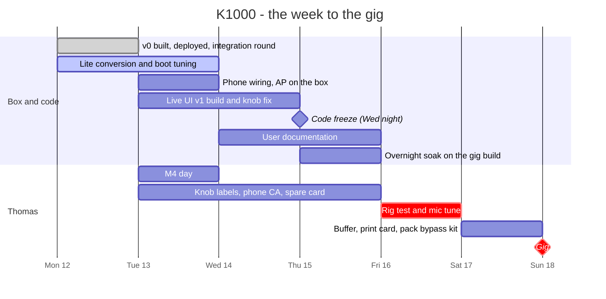

# K1000 — roadmap

Where K1000 stands, what comes next and in which order, and the gates that decide what plays on
Sunday 18 October. Decisions live in `DECISIONS.md`. Each phase below keeps its own dated progress
lines.

*Status as of Tue 2026-10-13, morning.* Live UI v1 (D-009) is accepted on the box and deployed
(`167776b`, with the polish `8e86ddb`; 979 tests): SHOW/ALIGN/SETUP, the spectrum and the notch
helper, the knob fixes, laptop access and the `/tune` page. The phone PWA and the K1000 Wi-Fi are
wired into main (`f7aa58b`) and the access point is up on the box, not yet proven with a real phone.
The box runs Raspberry Pi OS Lite (D-006, cloud-init off). Power-cut drill done at 06:00: the
state files came back byte-identical, boot 10.4 s; the clock came back 3.5 min behind (no battery
clock, no time server at a gig). The user manual is written (`docs/manual`). An overnight soak
runs until the morning. The MOTU M4 is picked up today; the rig test is Fri 16 and the gig Sun 18.
*Afternoon:* D-011 is on the box (`24cba65`, knob tags off since 13:39). D-013 is on the box
since 14:31 (`dd740ce`): buttons B1 PAGE · B2 BAND/UNLOCK · B3 NOTCH · B4 MUTE, SETUP grouped by
speaker floor, choose-then-set. Thomas, 14:2x: "push the timing": Sunday is also a field test for
the phone v2 (APK, one merged page, SETUP and RTA on the phone); the knobs are the fallback.
*(Mon 2026-10-12, evening: v0 ran on the box after the integration round, `ca742e7`, 502 tests.)*

## At a glance

| Phase | Goal | State | Gate |
|---|---|---|---|
| 0 — Frame | Questions answered, lead picked | **done** 12/10 | — |
| 1 — v0 for the gig | A trustworthy, bypassable head for Sunday | **in progress**: code done and deployed, Lite done, power-cut drill done; M4 live 16/10 (loop-tested: routing, levels, 20.3 ms), buttons confirmed, 3 A PSU; USB drills and gig soak still to do | Fri 16 rig test |
| 2 — Live UI v1 | Every live control on one page, EQ curve over a spectrum; phone PWA | **pulled forward in part** (Thomas, 12/10): UI v1 accepted on the box 13/10; phone wired, AP up, real phone still to prove | Wed 14 freeze, Fri go/no-go |
| 3 — Field trial | The gig is the first outing; debrief | Sun 18 | debrief Mon 19 |
| 4 — Assist & measurement | Spectrum tools, suggest-notch, phone mic as a measurement input | steps 1-2 pulled in for the tests (Thomas, 14/10): on the box `6a537bb`; the rest after the gig | Fri 16 rig test |
| 5 — Road-proofing | Read-only root, enclosure, power, spare surface | after the gig | — |

## The week to the gig

| Day | Box and code (Claude) | Thomas |
|---|---|---|
| **Mon 12** ✅ | v0 built, deployed, reboot proven; integration round (drills, review, 42 fixes, re-accepted); phone PWA built and reviewed in a worktree; Lite conversion prepared; UI v1 design started | Knob corners confirmed; 10 clicks = +10; fast turns feel inaccurate; go for the Lite reboots |
| **Tue 13** | Lite conversion applied with timed reboots; phone wiring + smbus2 + licence headers; AP up on the box (hostapd); UI v1 build starts | M4 day (`docs/05-m4-day.md`): detect, tone check, profile `m4`, loop and leak tests, 1 h soak |
| **Wed 14** | UI v1 build, knob fast-turn fix, accept on the box. **Freeze in the evening**: what is not accepted by then is switched off or rolled back | Knob labels on the shell; phone: install the CA, join by QR, install the PWA (`docs/06-phone.md`) |
| **Thu 15** | Gig profile `m4` pinned, gig `target_level` set; **overnight soak** on the gig build; user documentation written and checked | Another project in the afternoon. Fresh Lite on a second SD card → `bootstrap.sh` makes the spare |
| **Fri 16** | Standby for fixes | **Rig test + mic tune** (`docs/02` §6), the go/no-go per item (below). Same day as another project, where Thomas is support only |
| **Sat 17** | Fixes from Friday only | Buffer; print the operator card; pack the bypass kit, labelled |
| **Sun 18** | — | **Gig**, bypass kit in the case |

### Gates

1. **Wed 14 evening — code freeze.** Thursday's soak and Friday's test must run the build that
   plays on Sunday, so after this point only fixes for Friday's findings go in.
2. **Thu 15 night — soak.** `k1000-soak.sh --summary` must be clean (no xrun, no restart, no
   throttling) on the M4 with the gig `target_level`, PSU and closed case.
3. **Fri 16 — rig test go/no-go**, item by item:
   - K1000 in the chain at all. If no-go, the bypass, which is the old direct cabling.
   - Live UI v1. If no-go, the bypass: it is the only fallback (D-010); no software fallback to
     the v0 UI. `/opt/k1000.prev` is the rollback for a bad deploy only.
   - The phone. If no-go, the AP goes fully off and the knobs carry the show.
4. **Sun 18 — gig.** Afterwards, note what was touched, missed or failed.

## Workstreams now

| Stream | State | Next |
|---|---|---|
| v0 control service | done (`ca742e7`); on the box it is now UI v1 (`c49f006`) | no software fallback: the bypass (D-010) |
| Integration round | done: drills, five-lens review, 42 fixes, re-accepted; power-cut drill done Tue 13 (no sync: state files byte-identical, boot 10.4 s) | Friday: Thomas pulls the plug once at show level (item 11) |
| Lite OS (D-006) | done: the box converged to Lite (`k1000-lean.sh`, 972 desktop packages out), console guard, cloud-init off; `bootstrap.sh` checked on a fresh-card container | the spare card (Thu) |
| Phone (D-007) | wired into main (`f7aa58b`); AP up on the box on **hostapd** with PMF off (NetworkManager's AP on the Pi's chip drops older Android clients), captive DNS off, 5 GHz | Thomas: CA, join by QR, PWA install (`docs/06-phone.md`); go/no-go Friday |
| Live UI v1 (Thomas, 12/10) | accepted on the box Tue 13 (D-009) and deployed: `167776b` + polish `8e86ddb`; D-011 on the box (`24cba65`); **D-013 on the box** since 14:31 (`dd740ce`: buttons B1 PAGE · B2 BAND/UNLOCK · B3 NOTCH · B4 MUTE, SETUP by speaker floor, choose-then-set); D-017 (SETUP's knobs, Sat 17: E3 value, a fixed row, a popup for the risky rows) built, not on the box | Thomas at the bench today; D-013 on the box before the freeze, Wed evening; spectrum ON for Sunday (D-010), checked Friday |
| Knobs | corners confirmed; a click counts exactly one step (10 clicks = +10); fast-turn fix in UI v1 | the buttons: Knob test → `controls:` (the box still holds the defaults), which also confirms where B1–B4 sit for D-013's labels |
| Licence (D-008) | GPL-3.0-or-later, `LICENSE` in the repo; smbus2 and SPDX headers done | — |
| User documentation (Thomas, 12/10) | written: `docs/manual` 00–09, quick start, operator card; claim-checked against the code | Thomas fills in the card's Where line and the bypass patch, then prints |
| Interface (D-003) | MOTU M4 live on the box since 2026-10-16: 4/4 pinned, `target_level` 512, loop-tested (`docs/05-m4-day.md` §13) | USB drills, overnight soak at 512 |

## Phase 0 — Frame · *done 2026-10-12*

Answer the open questions (`docs/requirements.md` §5), pick the lead(s) (D-002).

- 2026-10-12 — project created; first approaches review: `docs/01-approaches-review.md`
  (proposed lead: CamillaDSP on a Pi, prototyped on the owned Zynthian V4 + a 4-out USB interface).
- 2026-10-12 — Thomas's answers → requirements draft 1; plan with a date: `docs/02-plan-to-sunday.md`
  (test Fri 16 / gig Sun 18 → v0 minimal, stable, bypassable). D-002..D-004 proposed.
- 2026-10-12 — D-002, D-004, D-005, D-006, D-007 and D-008 decided. D-003 (MOTU M4) is still open in
  the log; the M4 is picked up Tue 13.

## Phase 1 — v0 for the 2026-10-18 gig · *in progress* — plan: `docs/02-plan-to-sunday.md`

- Zynthian V4 + class-compliant USB interface (MOTU M4) + CamillaDSP **5.0.0-beta.1** (D-004).
- Fixed-slot pipeline: Lo-Cut, system PEQ, live notch slots, delay, polarity, Aux faders per group.
- Knobs and screen first; the phone joins through the box's own AP (D-007), gated Friday.
- Measure: boot-to-audio time, power-on/off thump into a box, overnight soak with xrun logging.
- Exit: audio is trustworthy on the bench, and the control loop feels fast.

Progress:

- 2026-10-12 — Box brought up on Raspberry Pi OS trixie, booting headless (`multi-user.target`,
  PipeWire/WirePlumber masked): ZynScreen overlay, MCP23017 knob driver on gpiod v2 interrupts,
  CamillaDSP 5.0.0-beta.1, CamillaGUI v5 beta.2. Build contract: `docs/03-v0-architecture.md`.
- 2026-10-12 — v0 control service deployed (`e3a3deb`): engine client, DSP config, knobs, screen,
  controller, systemd units, install.sh, soak tool. Measured after a reboot, `dev` profile: systemd
  userspace 15.0 s, k1000 on the engine at 11.7 s, ramp −40 → −20 dB in ~3 s (boot-to-audio ≈ 15 s),
  engine load ~1.1 %, k1000 ~12 % of a core, SoC 49.6 °C, throttled 0x0.
- 2026-10-12 — Review round on the deployed box (audio safety, operator UX, ops, phone/GUI, M4
  readiness) with drills, then two fix rounds, deployed the same evening: knobs and screen retried for
  life + KNOBS OFFLINE; MUTED band tells the truth (alerts, RAMPS IN BY ITSELF, READY only when
  Running); B4 reset LIVE-only with a second press, B3 MAIN-only, E3 sub delay wakes first; torn state
  comes back muted; mute and master-down saved at once; GUI Apply onto another card repaired; IN CLIP
  on the M4 input; per-profile `target_level`; render CPU 10.1 % → 1.6 % in-process; the engine unit
  waits for the M4 instead of restarting every second; log rotation 256 kB × 50; persistent journal;
  soak `--summary`; M4 bring-up tool. Combined tree on the box: 502 passed, 1 skipped (no shellcheck),
  0 failed. Re-accepted live: kill -9 of either process, the m4 pin without the M4 (3 engine starts in
  100 s instead of 56 in 67 s), a clean reboot to full level 15.5 s after kernel start, k1000 idle CPU
  ~5 % (was ~14–19 %).
- 2026-10-12 — Docs: operator card `docs/04-operator-card.md` (one printed A4 page), M4 procedure
  `docs/05-m4-day.md`, contract corrected to the build (`docs/03-v0-architecture.md` §7).
- 2026-10-12 — Lite conversion prepared (D-006): the removal plan matches the Lite image's own package
  list plus K1000's needs; guarded, detached apt runs; `bootstrap.sh` for a fresh card. Not applied
  yet: the permission system refused an agent's reboot; Thomas gave the go the same evening.
- 2026-10-12 — Thomas at the box: knob corners right, a click = one step, fast turns inaccurate;
  he set Lo-Cut on, mono subs on and master −19 dB himself.

### What the box has now (UI v1, Tue 13)

| Area | State |
|---|---|
| Pipeline | input trim, 8 system PEQ, 4 live PEQ + 2 shelves, split (mono-subs option), sub/top polarity, delay (whole samples), top Lo-Cut, sub low-pass, Aux group faders (balance), 4 output trims, Main master + mute |
| Knobs and screen | SHOW / ALIGN / SETUP pages, plus Knob test and PHONE; the live-EQ curve over the program spectrum with a PEAK pointer; B3 notch helper; ALIGN's delay (subs or tops, D-011) and Lo-Cut locked (B2 hold); reset and undo in SETUP; B4 mute on every page; B1 tap SHOW ↔ ALIGN, hold SETUP; SETUP by speaker floor with choose-then-set (D-013, `dd740ce`; D-017 built off the box: E3 value, a fixed row, a popup for the risky rows); meters with CLIP / IN CLIP; MUTED band with alerts; NO DEVICE / ENGINE DOWN |
| Audio safety | boots muted; ramp gated on Running; Aux4 marker; outside cuts kept, raises pulled down; pipeline restore and device repair; mute saved at once; torn state recovered muted |
| Ops | restart-forever units, device wait, watchdog, persistent journal, soak tool with `--summary`, M4 bring-up tool, rollback |
| Phone | The own-AP PWA, wired (master, balance, Lo-Cut, live EQ, mute); laptop access (2 h) for CamillaGUI, SSH and the `/tune` REW import over the K1000 Wi-Fi; CamillaGUI on the LAN |

### Left before Friday 16 (rig test)

| # | What | When |
|---|---|---|
| 1 | ~~Deploy the fix round; full suite; new start script; persistent journal cost~~ — done 2026-10-12 evening | ~~before Tue 13~~ |
| 2 | M4 day, `docs/05-m4-day.md`: detect, check tool, tone identification, profile `m4`, loop and leak tests, levels, presence drills, 1 h soak, report back | Tue 13 |
| 3 | Knob test → `controls:` in k1000.yaml; label the shell B1 PAGE · B2 BAND/UNLOCK · B3 NOTCH · B4 MUTE (D-013); fill in "Where" on the operator card (the corners are confirmed; buttons still to label) | Tue–Thu |
| 4 | Thomas's calls: output mapping (keep tops on outs 1-2), M4 `target_level` (256 vs 512/768), power-on mute policy (today: the saved mute), Sunday source and cables, PSU | by Thu 15 |
| 5 | Pin the M4 channel counts (4/4) in k1000.yaml after the probe; set the chosen `target_level` (next engine start) | Tue–Thu |
| 6 | Overnight soak at the gig `target_level`; `--summary` clean | Thu 15 night |
| 7 | ~~Boot race fbcon vs k1000 (console guard) and cloud-init off: proven by the Lite conversion's reboots~~ — done: cloud-init off on the box; the Tue 13 power-cut drill came back to SHOW | ~~Tue 13~~ |
| 8 | ~~Owner edits: `docs/02` §3/§6, D-003 wording, README "Sound state"~~ — done 2026-10-12 | ~~before Fri~~ |
| 9 | Phone: wire, AP up, Thomas installs the CA and the PWA; go/no-go at the rig test, else the AP goes off | Tue–Fri |
| 10 | ~~Live UI v1 accepted on the box by Wed evening, else Sunday runs v0~~ — accepted Tue 13 (D-009); the Friday go/no-go still applies (gate 3) | ~~Wed 14~~ |
| 11 | Power-cut check: pull the plug at show level, then power on again; the state file survives and the box comes back as it should | Fri 16 |
| 12 | Print the operator card and the quick start (D-013's buttons); pack the bypass kit, labelled, its patch written on the card | Sat 17 |

Friday itself is `docs/02` §6: thump check, gain structure (Meyer limit LEDs, then the phone's
ceiling = show level + 6 dB), sub alignment, Lo-Cut at 100 Hz (D-010; 160 only if the tops limit early), system EQ, live drill,
2-hour run.

## Phase 2 — Live-correction UI v1 · *pulled forward in part, 2026-10-12*

Thomas's direction after using the v0 panel (12/10): take sub delay and Lo-Cut off the front page;
put every live control on one page; show the applied EQ curve over a live spectrum, like a pro
console, with LS · 1 · 2 · 3 · 4 · HS band selection; a GEQ toggle was floated (recommendation: no;
parametric bands + the spectrum serve live notching better on 4 knobs).

- **For Sunday, if accepted by Wed evening:**
  - SHOW page: master on E1; freq, gain and Q of the selected band on E2–E4; band select on a
    button; the curve over the spectrum; the sub/top balance placed as the design decides.
  - ALIGN page: master, balance, sub delay, Lo-Cut (sub delay and Lo-Cut locked; top delay went to
    SETUP). Built and accepted on the box Tue 13 (D-009).
  - Thomas's bench asks, Tue 13 (D-011): Lo-Cut 2 Hz a click; E3 = one signed DELAY for subs or
    tops (SETUP › Top delay gone); E1–E4 tags dim grey by default (`ui.knob_tags`; Thomas's box:
    `off`, a sticker on the shell). On the box since `24cba65` (Tue 13, 10:46); tags off 13:39.
  - SETUP keeps the rest; one B1 gesture returns to SHOW (D-013: a tap from ALIGN or SETUP).
  - Thomas's bench asks, Tue 13 afternoon (D-013): SETUP grouped by speaker floor (TOPS, SUBS,
    INPUT, LIVE EQ, PHONE, BOX), every ON/off or choice chosen with E2 and set by a push; buttons
    B1 PAGE (tap SHOW ↔ ALIGN, hold SETUP) · B2 BAND/UNLOCK · B3 NOTCH · B4 MUTE. On the box
    since 14:31 (`dd740ce`).
  - Thomas's bench asks, Wed 14 (D-015): SHOW Q on E3 and GAIN on E4 (`E4 TO CUT`); ALIGN DELAY on
    E2 and BALANCE on E3 (the locked pair at the bottom, one badge between them); every value flush
    to its corner's outer border; smaller legends and values (SHOW's graph 130 → 152 px); IN L R
    input meters beside SUB/TOP on both pages. On the box since `6a537bb` (Wed 14, 12:26).
  - Thomas's rig feedback, Fri 16 (D-016, **proposed**, all off by default): SETUP › TOPS
    De-harsh (a dynamic cut at 2.7 kHz on hard attacks only), SUBS Loudness (more sub as the master
    goes under a reference, never louder than at it), INPUT AUX IN 1/2 (the M4's IN1 as a mic, or
    IN1 + IN2 as a line pair, into the program; until now they played nothing), on the knobs, the
    screen and the phone. Built and tested off the box (the engine config byte for byte f2671b0's
    with all three off); not deployed yet. Thomas tries each at the rig and decides; how to set them
    by ear: `docs/manual/05-tuning.md` §9. His USB-stick player ask goes after the gig (below).
  - Thomas at the rig, Sat 17 (D-017, decided): SETUP's knobs. E1 ITEM · E2 GROUP · **E3 VALUE**
    (turn = change, an everyday ON/off right ON / left off), the selected row fixed on the 4th
    screen row, and for the risky rows (every rebuild, both polarities, Lo-Cut: Claude's list, his
    to change) a popup `now → proposed` applied only by an E3 push. Built and tested off the box;
    not deployed yet (his call: before the gig or after it).
  - Knob fast-turn fix.
  - Design: `docs/07-live-ui-v1.md` + `docs/ui/v1/`. Knob analysis: `docs/08-knob-precision.md`.
- **Phone PWA on the box's own AP** (D-007): live EQ curve with draggable bands, "notch here",
  hold-to-mute; HTTPS from the name-constrained local CA. Phone setup: `docs/06-phone.md`.
- **After the gig:** presets per place type, EQ A/B, the curve and spectrum on the phone, and a GEQ
  view only if the field trial asks for it. An **internal player for a USB stick** (Thomas, 16/10:
  ambient and test playback without the phone): a player process feeding the program beside LINE
  IN 3/4, the stick's mount rules, play/stop from SETUP and the phone (D-016 §Not done).
- **Phone orientation** (Thomas, 12/10): portrait stays the default and stays locked for Sunday
  (one thumb, hold-to-mute under it). After the gig, a landscape "EQ focus" layout when the phone is
  turned (wide curve and spectrum, band controls at the side), the way console remote apps adapt
  rather than force.
- **Android app** (Thomas, 12/10): not before Sunday. After it, a thin WebView shell (the UI stays
  served by the box), published as a signed APK in the GitHub releases for sideloading, not on the
  Play Store. What it adds over the PWA:
  - It bundles the K1000 CA, trusted only for 10.42.0.1 and `k1000.home.arpa`, so there is no CA
    install in Android settings.
  - It joins the K1000 Wi-Fi itself and binds its traffic to it, so mobile data stays on for the rest
    of the phone (today: airplane mode + Wi-Fi during the show).
  - It keeps the screen awake and gives real haptics.
  - It gives raw mic access (Android's unprocessed source) for the phone-mic measurement (Phase 4).

  Cost ~1–2 days with real-phone testing; the signing key stays out of the repository.

## Phase 3 — Field trial

- The 18/10 gig is the first outing; log what was touched, what was missing, whether Wi‑Fi held.
- Decide the final hardware shape (Zynthian shell kept / Pi 5 + Stream Deck+ / Pi 5 + DAC8x).

## Phase 4 — Assist & measurement

- Spectrum view (CamillaDSP v5) with peak markers; tap-to-notch; supervised suggest-notch.
- Noise generator + RTA on the measurement mic; later a transfer-function view; REW import/export.
- **Phone mic as a walk-around measurement input** (Thomas, 2026-10-12). It is possible because the
  PWA runs over HTTPS: browsers give a page the mic only in a secure context. Steps, each usable on
  its own:
  1. Phone RTA: the phone's own mic spectrum behind the PWA's EQ curve, with peak hold, for spotting
     ringing and harshness. Mic processing is requested off (no AGC, noise suppression or echo
     cancellation); check that Chrome on the Pixel 4a honours it.
  2. A live response view, magnitude only: the phone's mic spectrum and the box's program spectrum
     (CamillaDSP capture side), each averaged over ~10–20 s, then subtracted. That gives PA + room
     without pink noise, and the long averaging makes time alignment unnecessary. Averaging while
     walking the room gives a spatial average.
  3. Phone mic calibration, once at the bench: the measurement mic on M4 input 1 and the phone side
     by side on pink noise. The box stores the phone's correction curve. Phone mics are weak below
     ~100 Hz, so sub alignment stays with the measurement mic.
  4. Suggest-notch on that response: cuts only (dips are usually cancellations), proposed as a free
     live PEQ, applied only on a tap.
  5. Later, a time-aligned transfer function with coherence, the way Smaart and Open Sound Meter do it
     (OSM is GPL-3, so its approach and code are compatible with K1000's licence).
- **Steps 1 and 2 pulled in for the rig test** (Thomas, Wed 14): the phone mic line (PGM ▾ PHONE
  MIC · BOTH, its own PEAK) and ≋ MEASURE › RESPONSE on the v2 page, the box's `pgm` windows
  (docs/14 §3.6), app 0.2.2. On the box since `6a537bb` (Wed 14, 12:26); first real-music run at
  Thursday's soak. Use and limits: `docs/11-phone-mic.md`. Steps 3-5 stay after the gig.

## Phase 5 — Road-proofing

- Read-only root, watchdog/supervisor, mute-at-boot (+ optional output mute relay), enclosure,
  power, labelling, a spare surface.
- A box gesture to release CamillaGUI Aux cuts.
