# 4 — Usage

How to run a show with K1000: the panel, the three pages, the mute, the phone, the end of the
night and the bypass. This chapter follows the code as built (UI v1, decision D-009 in
[`DECISIONS.md`](../../DECISIONS.md)). The pictures are drawn by that code (`docs/ui/`).

Two printed pages go in the case: the [quick start](../13-quick-start.md) for someone who has
never seen the box, and the [operator card](../04-operator-card.md) for the operator. Print them
with `tools/make-print.sh` ([chapter 8](08-development.md#printing-the-cards)). What every screen
message means is in [chapter 6](06-troubleshooting.md).

## 1. The panel at a glance

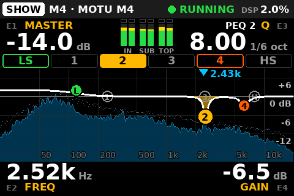

**Controls.** Four push-encoders **E1–E4** and four buttons **B1–B4**. The screen draws each
knob's value at its corner: **E1 top-left, E2 bottom-left, E3 top-right, E4 bottom-right**. Which
physical knob and button is which is set once with SETUP › Knob test ([§5.4](#54-knob-test)) and
the `controls:` map ([chapter 3](03-configuration.md#5-controls)). Label the buttons on the
shell: **B1 PAGE · B2 MUTE · B3 BAND/UNLOCK · B4 NOTCH**, and the knobs **E1–E4**: Thomas's box
draws no `E1`…`E4` tag on the screen (`knob_tags: off` in k1000.yaml's `ui:` section). `dim` puts a
small grey tag by each label (the built-in default, as in the pictures), `bright` a cyan one
([chapter 3 §5](03-configuration.md#5-controls)).

| Gesture | Means |
|---|---|
| Turn | One click = one step. Only FREQ, the Lo-Cut frequency and master **down** speed up on a fast turn (up to ×4); master **up** never does |
| Push held + turn | Fine steps, where the value has them (frequencies, Q, delays). The edit box says `FINE`. Releasing a push after turning never selects anything |
| Tap a button | Its action on this page |
| Hold a button | Fires at **0.8 s**, while still held |

**The screen**, top to bottom:

- **The status bar.** The page (white pill), `MUTED` (red pill), `CLIP` / `IN CLIP` (red pills),
  the profile and device (`M4 · MOTU M4`), the engine (● `RUNNING` green, `STARTING` / `PAUSED`
  yellow, red when down) and its load (`DSP 2.0%`). A system alert takes the bar in its own colour
  ([§7](#7-alerts-hints-and-pills)).
- **The values**, each next to its knob, in white. The one being edited turns amber for 2.5 s.
- **The meter**: Sub L, Sub R, Top L, Top R ([§3.5](#35-the-meter-and-clipping)).
- **The amber strip**: hints, what your own press just did.
- **The pills** (SHOW only): states that last, on the bottom row.

**Colours.** Amber = being edited, and hints. Red = mute, clip, a critical alert. Orange = a
warning. Blue = a passing state (`RAMPING IN`). Cyan = the spectrum PEAK (and the knob tags when
`ui.knob_tags` is `bright`).

**Pages.** A B1 tap steps **SHOW → ALIGN → SETUP** and back to SHOW. **B1 hold = SHOW** from
any page (on the Knob test, any hold but B2 goes back to SETUP first). ALIGN and SETUP go back to
SHOW by themselves after 60 s without a knob or button event (not while a SETUP confirm is
pending). PHONE and the Knob test open from SETUP and stay until you leave them.

| Button | SHOW | ALIGN | SETUP |
|---|---|---|---|
| B1 | tap: next page · hold: SHOW | the same | the same |
| B2 | **hold: mute / unmute** (a tap only shows a hint) | the same | the same, also on PHONE and the Knob test |
| B3 | tap: next band | **hold: unlock E3/E4** · tap: lock again | hint only |
| B4 | tap: **notch helper** · hold: hint only | hint only | hint only |

## 2. Power on to sound

1. **Speakers off**, source quiet.
2. The M4 on the Pi's USB, its rear power switch on.
3. Power K1000. About 10 s later the screen shows SHOW and the engine `RUNNING`.
4. What comes next depends on how the box was switched off:
   - **Saved muted** (the normal end of a night): the MUTED band says `READY · hold B2 to unmute`.
     Nothing plays until you unmute.
   - **Saved unmuted**: the status bar shows the blue `RAMPING IN` and the band says
     `RAMPS IN BY ITSELF · hold B2 to keep muted`. The engine always starts muted at −40 dB;
     K1000 fades it to the saved master over about 3 s, and only once audio really flows. At
     power-on the ramp starts before the screen and the knobs are up (on the author's box: the ramp
     from 8.9 s after the kernel starts, the knobs at 10.1 s, the saved level by about 12 s), so the
     band shows for a second or two at most and the box is often already live when you look. A B2
     hold then mutes it, as on any unmuted box.
   - `NO AUDIO FLOWING · HELD MUTED`: the engine is not processing yet (the M4, its USB, its
     power). K1000 waits, with no timeout.
5. **Speakers on**, with the source still quiet.
6. Saved muted: hold B2 to unmute, then E1 up to the show level. Saved unmuted (no MUTED band): it
   already plays at the saved master, so do **not** hold B2 (that mutes); bring the source up.

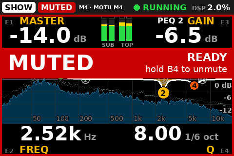 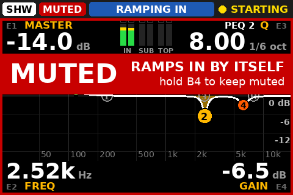

A brand-new box (no saved state at all) starts unmuted and ramps to −20 dB. A box whose saved state
was lost or torn starts **muted**, master at −20 dB, with the hint `STATE REBUILT · CHECK MASTER`
or `NO SAVED STATE · CHECK MASTER`: check master and balance before you unmute
([chapter 3 §10](03-configuration.md#10-the-state-files)).

## 3. SHOW, the front page

Everything a show needs: the master, the live EQ, the meter and the spectrum.

| Knob | Does | Step | Fine (push held) |
|---|---|---|---|
| E1 **MASTER** | The Main fader, −80 … 0 dB | 0.5 dB; down speeds up, up never | — |
| E2 **FREQ** | Frequency of the selected band | 1/12 octave, speeds up | 1/48 octave |
| E3 **GAIN** | Gain of the selected band: bells −20 … +6 dB, shelves −12 … +6 dB | 0.5 dB | — |
| E4 **Q** | Width of the selected band (shelves: `SLOPE`) | Q × 1.12 (1/6 octave) | Q × 1.03 (1/24 octave) |
| B3 tap | Next band: **LS → 1 → 2 → 3 → 4 → HS**, then LS again | | |
| B4 tap | The notch helper ([§3.2](#32-notching-a-ring-in-3-gestures)) | | |

Under the Q value, the width in octaves (`8.65` = `1/6 oct`). The E3 label names the band
(`PEQ 2 GAIN`, `LO SHELF GAIN`).

**The band chips.** The selected band is filled amber. A band in use is outlined orange (a cut) or
green (a boost); a free band (0 dB) is faint. The live EQ is four bells (P1–P4) and a low and a
high shelf, on top of the system EQ, which it never changes.

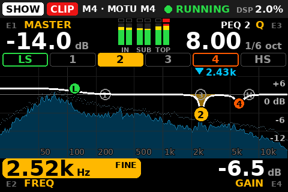 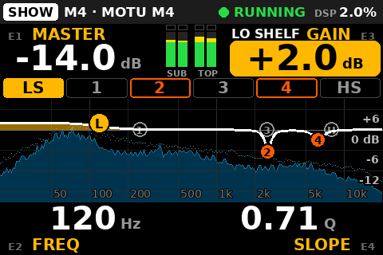

**Master-up guard.** Master may rise at most **6 dB within any 2 s**, whoever raises it (knobs,
phone, console). Further up-clicks are refused with the hint `MASTER: SLOW DOWN`. Down is never
limited. The amount is `controls.master_up_guard_db` ([chapter 3 §5](03-configuration.md#5-controls)).
Master, balance and the mute move with a 0.1 s fade.

### 3.1 The curve and the spectrum

- **The white curve** is the live EQ, exactly as the engine computes it, with a marker per band
  (`L`, `1`–`4`, `H`), on a scale labelled +6 to −12 dB. The system EQ is not drawn.
- **Behind it, the program spectrum**: what comes **in** (the program inputs, before any EQ), in
  1/24-octave bands, about 10 times a second. It runs only while SHOW is on screen and
  SETUP › Spectrum is ON. It shows the program, not the room: a ring that feeds back through a
  microphone in the program shows up; a room mode does not.
- **PEAK**: a small cyan pointer with its frequency (`▼ 2.43k`). It marks a narrow band standing
  10 dB above the median of the octave on either side, for 1.5 s, between 40 Hz and 16 kHz.
  **Never on silence**: the peak band must reach −80 dBFS and the program −60 dBFS RMS
  ([chapter 3 §7](03-configuration.md#7-spectrum)). It says PEAK, not feedback: a held note looks
  the same. And since it is read before the EQ, cutting the ring does not make it go.
- After an engine start, the spectrum comes back by itself within a few seconds.
- A grey **`NO SPECTRUM`** means the engine refuses to give one. The sound is not affected:
  switch SETUP › Spectrum OFF. With Spectrum OFF, SHOW draws the curve alone.

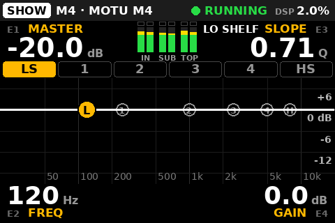

### 3.2 Notching a ring in 3 gestures

**B4, E3 down, E4 up.**

1. **B4** (tap). The notch helper takes a **free bell** (P1–P4 at exactly 0 dB: the selected band
   if it is free, else the first free one; never a shelf). It sets its Q to **8.65 (1/6 octave)**
   and, if a PEAK is shown, its frequency to the PEAK. **The gain stays at 0 dB**, so nothing is
   audible yet. The band is selected, GAIN is highlighted, and the strip says
   `P3 · 2.44k · E3 TO CUT` for 4 s.
2. **E3 down**: the cut. 12 clicks = −6 dB.
3. **E4 up**: narrower. 6 clicks take Q from 8.65 to 16, the maximum. To centre it, E2 with its
   push held (1/48 octave per click).

| Case | What B4 does |
|---|---|
| The PEAK sits within 1/6 octave of a bell **already in use** | Selects that bell and changes nothing (cut it deeper with E3) |
| No PEAK (nothing on the spectrum, or Spectrum OFF) | Sets the free bell up at its own frequency: `P2 · 1.00k · NO PEAK · E3 TO CUT`. **Cut first, then sweep**: E3 down (about −6 dB; at 0 dB the bell is inaudible wherever it sits), then E2 until the ring drops (250 Hz → 2.5 kHz is about 40 clicks), then E4 up to narrow |
| `NO FREE BAND` | All four bells are in use. Reuse one (B3 to select it), or reset the live EQ in SETUP |

A B4 **hold** on SHOW only says `RESET LIVE EQ: IN SETUP`. Nothing on SHOW resets the live EQ.

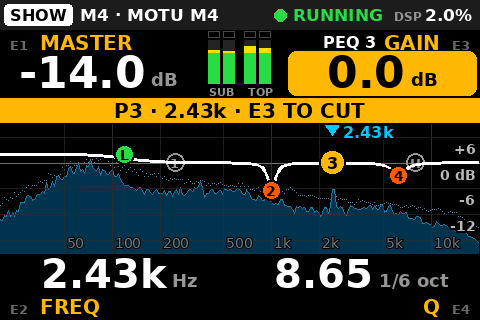 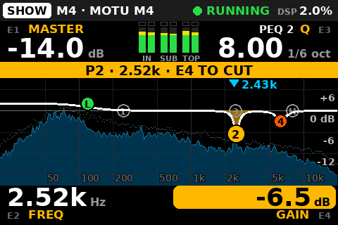

Cut narrow and only as deep as needed; several small notches beat one huge one. More in
[chapter 5 §8](05-tuning.md#8-live-notching-at-the-show).

### 3.3 Pills

States that last stay visible on SHOW's bottom row, between the E2 and E4 labels, where neither a
hint nor the MUTED band covers them:

| Pill | Colour | Means |
|---|---|---|
| `LAPTOP OPEN 1:59` | orange | SETUP › Laptop access is open (hours:minutes left) |
| `LO-CUT OFF` | orange | The tops' Lo-Cut is off |
| `POL INV SUB`, `POL INV TOP`, `POL INV SUB+TOP` | orange | A polarity is inverted |
| `MONO SUB` | grey | Mono subs is on |
| `AUDITION TOPS`, `AUDITION SUBS` | grey | The bench profile plays one group only |

When they do not fit, they fold into a `+N` pill, grey ones first. Spectrum OFF has no pill.

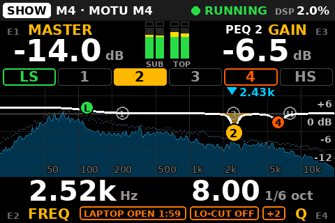

### 3.4 Hints on SHOW

Hints use the amber strip over the band chips, for 2.5 s (4 s for the notch helper and laptop
access). Example: `MASTER: SLOW DOWN`.

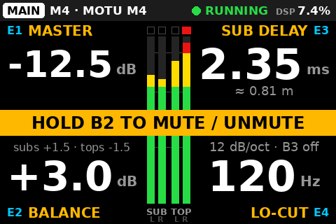

### 3.5 The meter and clipping

Four bars, Sub L, Sub R, Top L, Top R, −60 … 0 dBFS: green below −18, yellow to −6, red above. A
red box on top = that output clipped. ALIGN shows the same meter, larger.

| Shows | Means | Do |
|---|---|---|
| `CLIP` (red pill) | An output reached full scale, or the engine counted clipped samples (held 3 s) | Master down; check the live EQ for a big boost |
| `IN CLIP` (red pill) | A program input reached −0.5 dBFS (held 3 s) | Source down, or inline pads. No K1000 knob fixes it |

The Meyers start limiting around −14 dBFS at the M4 outputs (research,
[chapter 5 §3](05-tuning.md#3-gain-structure)).

## 4. ALIGN

The system settings you set before the doors and leave alone: balance, the sub/top delay, Lo-Cut.

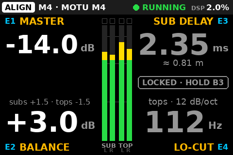

| Knob | Does | Step | Fine (push held) |
|---|---|---|---|
| E1 **MASTER** | As on SHOW | 0.5 dB | — |
| E2 **BALANCE** | Subs against tops, −12 … +12 dB; + = subs up. Subs get +b/2, tops −b/2 (`subs +1.5 · tops -1.5`) | 0.5 dB | — |
| E3 **DELAY** | Which side is late, and by how much: clockwise from 0 the **subs**, anticlockwise the **tops**, up to 50 ms either way. The size big, the side and the distance under it (`SUBS LATER · 0.81 m`, `TOPS LATER · 0.43 m`, `ALIGNED`) | 0.1 ms | 1 sample (1/48 ms) |
| E4 **LO-CUT** | The tops' high-pass, 12 dB/oct, 20 … 300 Hz | 2 Hz, speeds up (8 Hz on a fast spin) | 1 Hz |

**E3 and E4 are locked.** A turn shows `LOCKED · HOLD B3 TO EDIT` and changes nothing.

- **Hold B3**: unlocked (`DELAY + LO-CUT UNLOCKED`). An amber `EDIT 0:30` badge counts down.
- Any knob or button on ALIGN renews it, so **30 s without input locks again**.
- **A B3 tap** locks at once (`DELAY + LO-CUT LOCKED`). Leaving ALIGN locks too.

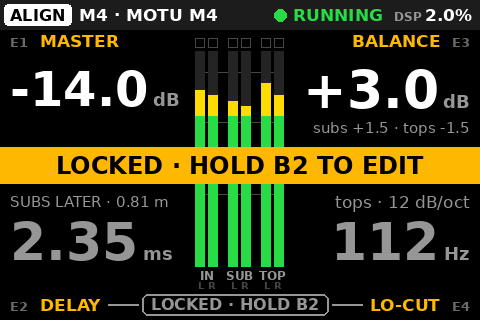 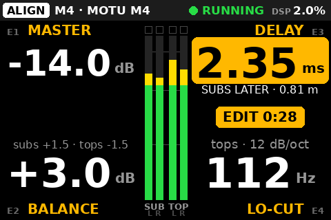

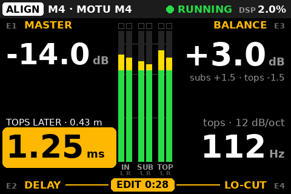 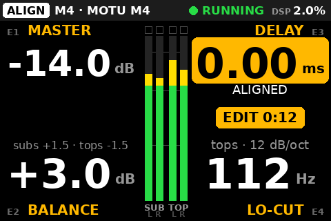

**DELAY is one setting for both sides** (D-011). Subs in front of the tops: turn clockwise, the
subs wait (`SUBS LATER`). Tops in front: turn anticlockwise past 0, the tops wait (`TOPS LATER`).
Only the late side is ever delayed. Turning through zero stops one click on `0.00 · ALIGNED`; the
next click goes to the other side. It also keeps a wake-up click: after 2.5 s at rest, the first
click only wakes it (`DELAY · TURN AGAIN TO CHANGE`). Each change dips the group whose delay
changes (the subs or the tops; both when one write changes both, e.g. a quick turn through
zero): K1000 mutes the group around the write so it does not click. Do alignment before the show.

**Lo-Cut** frequencies sit on a 2 Hz grid; odd values only with the push held. A value saved
between two steps (112.25 Hz) stays until the first click, which lands on the next step in that
direction (114 up, 112 down).

**Lo-Cut off**: E4 reads `OFF` with `on/off in SETUP`. Switching it is SETUP › Lo-Cut.

Why ALIGN is not the front page: a wrong-knob turn on a delay or a Lo-Cut during a show is worse
than no turn at all. The lock makes it a deliberate act. How to set these: [chapter 5](05-tuning.md).

## 5. SETUP

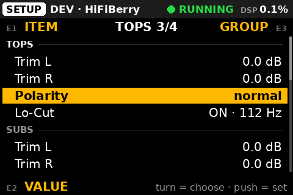

**E1 turn** picks the item (the counter says `13/19`). **E2 turn** changes a number. **E1 or E2
push** selects: it flips a switch, runs an action or opens a page. Items marked **×2** need a
second push within 5 s; the first push puts `PUSH AGAIN` on the row and a hint in the footer.
Moving to another item, or leaving the page, drops it. E2 turned on an item that is not a number
says `PUSH TO CHANGE`.

| Item | How | Does |
|---|---|---|
| Input trim | E2 | −24 … +12 dB, 0.5 dB. Acts after the converter: it cannot fix `IN CLIP` |
| Sub polarity, Top polarity | push | `normal` / `INVERTED`. The group dips briefly. Pill `POL INV …` |
| Sub low-pass | push | On/off: a 12 dB/oct low-pass on the subs |
| Sub LP freq | E2 | 40 … 250 Hz, 1/12 octave |
| Trim Sub L, Trim Sub R, Trim Top L, Trim Top R | E2 | −24 … +6 dB: to match boxes or sides, not to set the level |
| Mono subs | push ×2 | Both subs get L+R. **Keep it ON with one cable to both subs** (OUT3, D-012): OFF puts the left channel alone on them. Rebuilds the pipeline: `PUSH AGAIN TO APPLY (MAY CLICK)`, then the blue `APPLYING SETUP…` with Main muted around it |
| Audition (dev) | push ×2 | Bench profile only: `SUM`, `TOPS`, `SUBS` on the two bench outputs. Rebuilds the pipeline |
| Profile | push ×2 | `DEV` / `M4`. Refused while `k1000.yaml` pins it (`PROFILE PINNED IN k1000.yaml`). About 1 s of silence, then the ramp |
| **Reset live EQ** | push ×2 | `PUSH AGAIN TO RESET ALL LIVE EQ`, then the four bells and both shelves go flat, smoothly: `LIVE EQ RESET · UNDO IN SETUP` (`LIVE EQ ALREADY FLAT` if there was nothing to reset) |
| **Undo reset** | push | Puts back exactly the live EQ the last reset flattened: `LIVE EQ RESTORED`. The row counts down (`UNDO 4:47`); `—` and greyed when there is nothing to undo (`NOTHING TO UNDO`) |
| **Lo-Cut** | push ×2 | `PUSH AGAIN TO SWITCH THE LO-CUT`, then `LO-CUT ON · 112 Hz` or `LO-CUT OFF`. Off parks the filter at 10 Hz (no pipeline change). Pill `LO-CUT OFF` |
| **Spectrum** | push | `ON` / `OFF`, saved. `DISABLED` when `spectrum: enabled: false` in `k1000.yaml` (`SPECTRUM OFF IN k1000.yaml`) |
| **Laptop access** | push ×2 to open, push to close | CamillaGUI, SSH and the `/tune` page from a laptop on the K1000 Wi-Fi, for 2 h ([§5.1](#51-laptop-access-and-the-tune-page)) |
| Phone | push | Opens the PHONE page ([§5.3](#53-the-phone-page)) |
| Knob test | push | Opens the Knob test ([§5.4](#54-knob-test)) |

**The undo** keeps one level, for **5 minutes, or until the next audible live-EQ edit**: a gain
moved off 0 dB on any band, from the knobs, the phone or CamillaGUI. That edit ends it and says
`RESET UNDO LOST`. Inaudible moves (B4, a frequency or Q turned on a flat band) keep it. The phone's
reset is the same reset: the box can undo it.

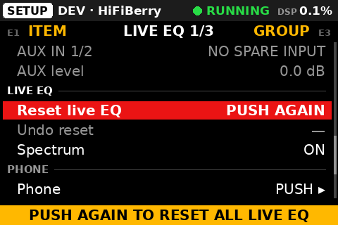 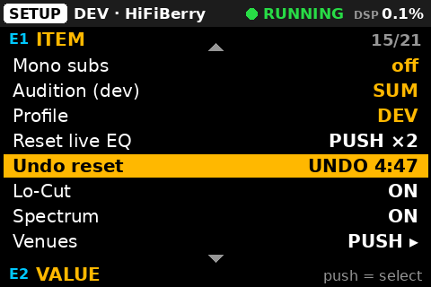

During a show, SETUP is for Reset live EQ and Undo reset only. Polarity, delays, trims, mono subs
and the profile belong before the doors.

### 5.1 Laptop access and the tune page

At the rig the laptop reaches the box over the **K1000 Wi-Fi**. A fence normally keeps CamillaGUI
and SSH away from that Wi-Fi; Laptop access opens exactly those two, for a while.

1. SETUP › Laptop access, **push twice** (`PUSH AGAIN: LAPTOP ACCESS FOR 2 H`). The row reads
   `OPENING…`, then `OPEN 2:00` counting down (hours:minutes); SHOW shows the pill
   `LAPTOP OPEN 1:59`; the hint says
   `LAPTOP OPEN 2 H · GUI :5005 · SSH`.
2. SETUP › Phone: while access is open, the PHONE page prints the Wi-Fi password on every step (a
   laptop cannot scan the QR). Join **K1000** with it.
3. On the laptop:
   - the tune page: `https://10.42.0.1/tune` (it needs the K1000 CA like a phone, or accept the
     browser's warning once);
   - CamillaGUI: `http://10.42.0.1:5005/gui/index.html` (press *Fetch from DSP* before editing);
   - SSH: `ssh k1000@10.42.0.1`.
4. Done: **one push** on SETUP › Laptop access (`LAPTOP ACCESS CLOSED`).

It also closes by itself after **2 hours** (`LAPTOP ACCESS CLOSED (2 H)`), when the k1000
service stops or starts again, and at every boot. Closing refuses new connections at once; an open
SSH session or GUI page stays until it ends. **Phones on the K1000 Wi-Fi reach the same two ports
while it is open**: open it for the tune, close it after.

| Row or hint | Means |
|---|---|
| `N/A` (greyed), `LAPTOP ACCESS: NOT AVAILABLE` | No laptop-access service on this box |
| `LAPTOP ACCESS: NO ANSWER (SEE LOG)` | The root helper did not answer: [`docs/06-phone.md`](../06-phone.md) §7 |
| `LAPTOP ACCESS NO WI-FI FENCE (AP NOT SET UP)` | There is no K1000 Wi-Fi to open: use the wired network |

**The tune page** (`/tune`) imports a measured EQ: paste REW's *Export filter settings as text*
(or EqualizerAPO `Filter` lines, or `125 Hz -4 dB Q 5` typed by hand), check the preview on the
eight system bands, **Apply** (with a confirm; click-safe, saved at once), and **Undo** if needed
(one level). Peaking filters only, eight at most. How to measure and decide:
[chapter 5 §7](05-tuning.md#7-system-eq).

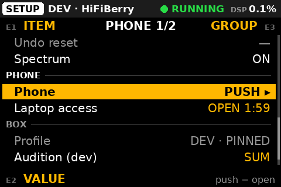

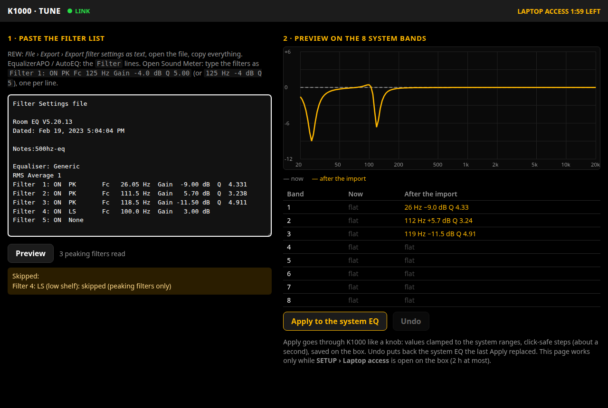

### 5.2 Hints on SETUP

The footer carries the hints and, when muted, the MUTED strip. The confirm hints:
`PUSH AGAIN TO APPLY (MAY CLICK)`, `PUSH AGAIN TO RESET ALL LIVE EQ`,
`PUSH AGAIN TO SWITCH THE LO-CUT`, `PUSH AGAIN: LAPTOP ACCESS FOR 2 H`.

### 5.3 The PHONE page

The QR codes a phone needs, and the phone switch. **E1 turn**: the next code, `1 · JOIN WI-FI` →
`2 · OPEN K1000` → `FIRST TIME` (the certificate page). Once a phone is on the Wi-Fi the page shows
step 2 by itself. **E1 push**: phone control on/off (`PHONE CONTROL ON` /
`PHONE OFF · KNOBS ONLY`, kept across restarts). **B1**: leave (to SHOW). B2 still mutes.

The right column says `Wi-Fi AP ON` (green) or `Wi-Fi AP is OFF` (red, with the reason), the band
and channel, and how many devices are on the Wi-Fi and on the page (`1 on Wi-Fi · 1 on K1000`).
The phone itself: [§8](#8-the-phone).

### 5.4 Knob test

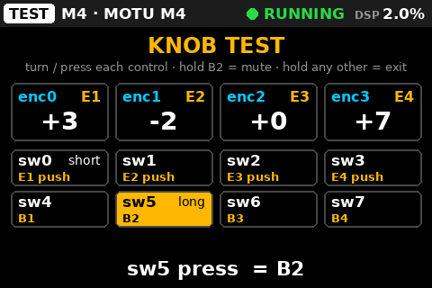

Every physical knob (`enc0`–`enc3`) and switch (`sw0`–`sw7`) with the role the `controls:` map gives
it, and a line for the last event. Turn and press each control, note which `enc`/`sw` index sits
where, and write them into `controls:` ([chapter 3 §5](03-configuration.md#5-controls)). **Hold B2
still mutes** here. Holding any other control goes back to SETUP.

## 6. Mute

**Hold B2 for 0.8 s, on every page**: SHOW, ALIGN (locked or not), SETUP (a pending confirm
survives), PHONE and the Knob test. A tap only shows `HOLD B2 TO MUTE / UNMUTE`.

- The mute and the unmute fade over 0.1 s. A mute is saved **at once**: switched off muted, the box
  comes back muted.
- **B2 acts on what the screen showed when you pressed it.** Pressed on an unmuted box, it always
  mutes. Pressed on a muted box, it unmutes only if nobody changed the mute meanwhile; if a phone
  did, it says `MUTE CHANGED · LOOK, HOLD B2 AGAIN`.
- While K1000 itself holds Main muted on its way in (`RAMPS IN BY ITSELF`), B2 means **keep it
  muted**, never unmute.
- K1000 never releases a mute it did not make (a mute from CamillaGUI stays).

**What MUTED looks like:** the red `MUTED` pill and a red frame on every page; on SHOW and ALIGN a
red band with the next step next to it; on SETUP and PHONE a red footer (a band would hide the row
or the QR); on the Knob test a red tag.

| Band text | Means |
|---|---|
| `READY · hold B2 to unmute` | Your mute (or a mute saved at power-off). The engine runs and K1000 is in sync |
| `hold B2 to unmute` | Muted, but the engine is not running yet or K1000 is not in sync: wait for `READY` |
| `RAMPS IN BY ITSELF · hold B2 to keep muted` | The engine (re)started: K1000 fades Main in over about 3 s by itself |
| an alert (`NO AUDIO FLOWING · HELD MUTED`, `APPLYING SETUP…`, `KNOBS OFFLINE …`) | Why it is still muted: [chapter 6 §1](06-troubleshooting.md#1-the-screen) |

From the phone: *HOLD TO MUTE* (0.6 s), *MUTED · HOLD TO UNMUTE* (1.2 s), with the same rule
([§8](#8-the-phone)).

## 7. Alerts, hints and pills

Three kinds of message. They never share a place or a colour.

| Kind | Says | Where | Colour |
|---|---|---|---|
| **Alert** | The system has a problem, or is in a passing state | The **status bar** (the page pill shortens to `SHW`, `ALN`, `SET`). Also inside the MUTED band. A critical alert is repeated over SHOW's chips when no hint is up | **Red** = critical (`KNOBS OFFLINE` takes the whole bar), **orange** = warning, **blue** = passing state |
| **Hint** | What your own press just did | The **amber strip**: SHOW's chip row, ALIGN's middle, SETUP's footer | Amber, 2.5 s (4 s for the notch and laptop access) |
| **Pill** | A non-default state that lasts | SHOW's bottom row | Orange (risky) or grey |

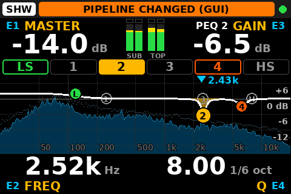 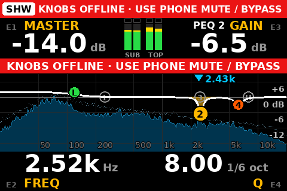

The alerts, most urgent first:

| Alert | Level |
|---|---|
| `KNOBS OFFLINE · USE PHONE MUTE / BYPASS` or `KNOBS OFFLINE · SOURCE DOWN / BYPASS` | critical. **B2 does nothing meanwhile.** The first text only while a phone can mute right now (phone servers on, SETUP › Phone on, the Wi-Fi up, the page served); otherwise the second |
| `NO DEVICE · MOTU M4`, `ENGINE DOWN` (also full-screen) | critical |
| `CANNOT SAVE STATE`, `ENGINE SYNC FAILED (SEE LOG)` | critical |
| `SETTINGS: …`, `k1000.yaml ROUTING FIXED UP (SEE LOG)`, `NO AUDIO FLOWING · HELD MUTED` | warning |
| `PIPELINE CHANGED (GUI)`, `CONFIG DRIFT (SEE LOG)`, `RESTORING ENGINE DEVICES`, `DEVICES CHANGED (GUI)`, a cut kept from CamillaGUI (`SUBS GROUP MUTED (GUI)`, `N CUTS/MUTES (GUI)`…) | warning |
| `APPLYING SETUP…`, `RAMPING IN` | passing state (blue) |

What each one means and what to do: [chapter 6 §1](06-troubleshooting.md#1-the-screen).

## 8. The phone

A page served by the box on its own Wi-Fi, **K1000**. It drives the same controller as the knobs:
same ranges, same click-safe moves, one state. The knobs stay the main surface and B2 the master
mute. Use the phone at a show only once it has been proven with your phone on your box
([`docs/06-phone.md`](../06-phone.md) §9 has the checklist).

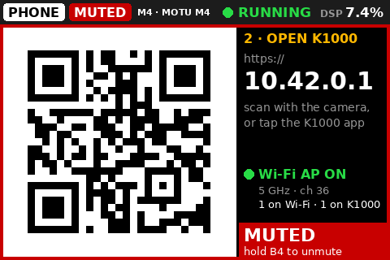

### 8.1 Once per phone, at home

1. **The K1000 certificate.** The phone needs a screen lock. Put the CA's public certificate
   (`k1000-ca.crt`) on the phone, or get it from the box: E1 to the `FIRST TIME` QR (or
   `http://10.42.0.1/` in Chrome), *Download the K1000 certificate*, *Keep*. **Do not tap the
   file.** Install it from Settings › Security › Encryption & credentials › Install a certificate
   › **CA certificate**. *Network may be monitored* is expected: this CA can only vouch for the
   K1000 box.
2. **Join the Wi-Fi.** SETUP › Phone, first QR. Scan it from Settings › Wi-Fi (the QR icon), not
   the camera app: Android then asks *K1000 has no internet access — Stay connected?* → **Yes**,
   **Don't ask again**. The password is printed under the QR.
3. **Open and install the page.** The second QR, or `https://10.42.0.1/`. Then *Install* in the
   page's top bar, or ⋮ › *Add to Home screen*.

Step by step, other Android menus and the fixes: [`docs/06-phone.md`](../06-phone.md) §3 and §7.

### 8.2 At the gig

**Airplane mode, then Wi-Fi on** → the phone joins K1000 → tap the K1000 icon. The top bar shows
`LINK` and `RUNNING`. With mobile data on, Android may send the page to the mobile network instead.

### 8.3 What it does

| Tab | Controls |
|---|---|
| **MAIN** | Master −6 / −1 / −½ / +½ / +1 dB. Balance ±½ / ±1 dB. Lo-Cut on/off (with a confirm) and its frequency (−10 / −2 / +2 / +10 Hz) |
| **LIVE EQ** | The six live bands on a graph. **Drag a dot** = frequency and gain. **Long-press empty space = notch here**: the first flat bell goes there at **−6 dB, Q 8, at once** (audible, unlike B4) and stays under the finger: slide to tune it. Per band: FREQ, GAIN, Q steps; hold = band flat. *RESET LIVE EQ…* with a confirm (the undo is on the box) |
| Always | **Hold to mute** (0.6 s; unmute 1.2 s), the four meters, the engine state, the box's alerts, changes made outside K1000 |

- **What a hold does is decided when the finger goes down**, and the button says it:
  *HOLD TO MUTE*, *MUTED · HOLD TO UNMUTE*, or *HOLD TO KEEP MUTED* (K1000 is bringing the sound in
  by itself). An unmute is cancelled if anyone changed the mute during the hold (*The mute changed
  meanwhile*). The phone buzzes when the box confirms; no answer in 1.5 s says *No answer from
  K1000: use B2 on the box*.
- **Master** rises at most +1 dB per tap and +6 dB per second for all phones together, and the
  box's master-up guard applies on top (6 dB within 2 s). Down is never limited.
- At most **4 phones** at once.

**It cannot**: anything in SETUP (profile, mono subs, delays, polarity, trims, input trim, sub
low-pass, the system EQ), Undo reset, the Spectrum switch, Laptop access, phone on/off. It has no
spectrum.

### 8.4 Switching it off

- **For now:** SETUP › Phone, push E1: `PHONE OFF · KNOBS ONLY`. The page still opens but controls
  nothing. It stays off across restarts.
- **For a show (no-go):** `phone: enabled: false` in `/etc/k1000/k1000.yaml` (then
  `sudo systemctl restart k1000`, between shows) **and** the Wi-Fi off the air:
  `sudo /opt/k1000/net/setup-ap.sh --down`. It stays down across reboots and later
  `install.sh --ap` runs; `setup-ap.sh --up` brings it back.
- **A laptop on the box's Ethernet** must not share its connection on 10.42.0.0/24 (NetworkManager's
  *Shared to other computers* default): that is the K1000 Wi-Fi's subnet, and the box keeps its
  Wi-Fi down while another interface holds such an address (PHONE: `Wi-Fi AP is OFF` · `eth0
  10.42.0.x` · `is in the AP subnet`). Share on another subnet, e.g. 10.43.0.1/24.

## 9. During a show

- Stay on **SHOW**. Master on E1; ring control with B4, E3, E4.
- Leave ALIGN locked and SETUP alone, except Reset live EQ / Undo reset.
- No CamillaGUI Apply, and Laptop access closed.
- Never Mono subs, Profile or Audition: they rebuild the pipeline (a click).
- `NO SPECTRUM`: SETUP › Spectrum OFF; the sound is not affected.

| Emergency | Do |
|---|---|
| Silence now | **Hold B2** |
| Feedback | On SHOW: **B4**, **E3 down**, **E4 up** (no B1 needed). From another page: hold B1, wait for the cyan PEAK (about 2 s), then B4 |
| `KNOBS OFFLINE` (B2 dead) | The phone's mute if the alert says so; else the source down. Then bypass |
| Any doubt about the sound | **Bypass** ([§11](#11-the-bypass)) |

## 10. End of the night

**Hold B2** (MUTED, saved at once) → **speakers off** → unplug K1000 → unplug the M4.

The next power-on stays silent (`READY · hold B2 to unmute`) until you unmute. Pulling the plug is
the normal way to switch K1000 off ([chapter 7](07-maintenance.md#power-cuts)).

## 11. The bypass

**Bypass = the source straight into the speakers, as it was cabled before K1000.** About a minute:

1. **Source down.** Hold B2 if K1000 still answers.
2. Unplug OUT1 TOP L, OUT2 TOP R and OUT3 SUBS (OUT4 too if it is patched) at the speakers.
3. Patch the bypass kit as written on the operator card.
4. **Source up slowly.** The bypass is about (2 − master) dB louder: +12 dB at master −10, with
   the trims at 0.

Lost in bypass: the Lo-Cut, the delays, the EQ, the mute. Details:
[chapter 6 §4](06-troubleshooting.md#4-the-bypass).

## 12. More pictures

Every screen the code draws is in `docs/ui/`, redrawn by `python3 -m k1000.ui.pages ../docs/ui`
([chapter 8](08-development.md#the-bench-console)): `show*.png`, `align*.png`, `setup*.png`,
`hwtest*.png`, `phone_*.png`, the alerts (`alert_*.png`, `knobs_offline*.png`, `no_device.png`,
`engine_down.png`, `unknown_status.png`) and the mute views (`muted*.png`).
