# 4 — Usage

How to run a show with K1000: the panel, the three pages, the mute, the phone, the end of the
night and the bypass. This chapter follows the code as built (UI v1, decision D-009 in
[`DECISIONS.md`](../../DECISIONS.md); the buttons and SETUP, D-013; the knob layout and the input
meters, D-015; SETUP's knobs, D-017). The pictures are drawn by that code (`docs/ui/`).

Two printed pages go in the case: the [quick start](../13-quick-start.md) for someone who has
never seen the box, and the [operator card](../04-operator-card.md) for the operator. Print them
with `tools/make-print.sh` ([chapter 8](08-development.md#printing-the-cards)). What every screen
message means is in [chapter 6](06-troubleshooting.md).

## 1. The panel at a glance

**Controls.** Four push-encoders **E1–E4** and four buttons **B1–B4**. The screen draws each
knob's value at its corner: **E1 top-left, E2 bottom-left, E3 top-right, E4 bottom-right**. Which
physical knob and button is which is set once with SETUP › BOX › Knob test
([§5.4](#54-knob-test)) and the `controls:` map ([chapter 3](03-configuration.md#5-controls)).
Label the buttons on the
shell: **B1 PAGE · B2 BAND/UNLOCK · B3 NOTCH · B4 MUTE**, and the knobs **E1–E4**: Thomas's box
draws no `E1`…`E4` tag on the screen (`knob_tags: off` in k1000.yaml's `ui:` section). `dim` puts a
small grey tag by each label (the built-in default, as in the pictures), `bright` a cyan one
([chapter 3 §5](03-configuration.md#5-controls)).

| Gesture | Means |
|---|---|
| Turn | One click = one step. Only FREQ, the Lo-Cut frequency and master **down** speed up on a fast turn (up to ×4); master **up** never does |
| Push held + turn | Fine steps, where the value has them (frequencies, Q, delays). A cyan `FINE` shows it, on the inner side: in the label row of a top knob (E1, E3), in the value box's inner corner for a bottom one (E2, E4). Releasing a push after turning never selects anything |
| Tap a button | Its action on this page |
| Hold a button | Fires at **0.8 s**, while still held |

**The screen**, top to bottom:

- **The status bar.** The page (white pill), `MUTED` (red pill), `CLIP` / `IN CLIP` (red pills),
  the profile and device (`M4 · MOTU M4`), the engine (● `RUNNING` green, `STARTING` / `PAUSED`
  yellow, red when down) and its load (`DSP 2.0%`). A system alert takes the bar in its own colour
  ([§7](#7-alerts-hints-and-pills)).
- **The values**, each next to its knob, in white, flush to its corner's outer edge (left corners
  left-aligned, right corners right-aligned) with its unit beside it. The one being edited turns
  amber for 2.5 s.
- **The meters**: IN L R (the program input), SUB L R, TOP L R
  ([§3.5](#35-the-meters-and-clipping)).
- **The amber strip**: hints, what your own press just did.
- **The pills** (SHOW only): states that last, on the bottom row.

**Colours.** Amber = being edited, and hints. Red = mute, clip, a critical alert. Orange = a
warning. Blue = a passing state (`RAMPING IN`). Cyan = the spectrum PEAK (and the knob tags when
`ui.knob_tags` is `bright`).

**Pages.** A B1 tap flips **SHOW ↔ ALIGN**. **A B1 hold opens SETUP** (from SHOW or ALIGN);
from SETUP, a B1 tap or hold goes back to SHOW. ALIGN and SETUP go back to SHOW by themselves
after 60 s without a knob or button event (not while a SETUP popup waits for its push). PHONE
and the Knob test open from SETUP and stay until you leave them: on PHONE a B1 tap goes back to
SETUP and a hold to SHOW; on the Knob test any hold but B4 goes back to SETUP.

| Button | SHOW | ALIGN | SETUP |
|---|---|---|---|
| B1 | tap: ALIGN · hold: SETUP | tap: SHOW · hold: SETUP | tap or hold: SHOW |
| B2 | tap: next band | **hold: unlock E2/E4** (DELAY, LO-CUT) · tap: lock again | hint only |
| B3 | tap: **notch helper** · **hold: the selected band IN / OUT** | hint only | hint only |
| B4 | **hold: mute / unmute** (a tap only shows a hint) | the same | the same, also on PHONE and the Knob test |

## 2. Power on to sound

1. **Speakers off**, source quiet.
2. The M4 on the Pi's USB, its rear power switch on.
3. Power K1000. About 10 s later the screen shows SHOW and the engine `RUNNING`.
4. What comes next depends on how the box was switched off:
   - **Saved muted** (the normal end of a night): the MUTED band says `READY · hold B4 to unmute`.
     Nothing plays until you unmute.
   - **Saved unmuted**: the status bar shows the blue `RAMPING IN` and the band says
     `RAMPS IN BY ITSELF · hold B4 to keep muted`. The engine always starts muted at −40 dB;
     K1000 fades it to the saved master over about 3 s, and only once audio really flows. At
     power-on the ramp starts before the screen and the knobs are up (on the author's box: the ramp
     from 8.9 s after the kernel starts, the knobs at 10.1 s, the saved level by about 12 s), so the
     band shows for a second or two at most and the box is often already live when you look. A B4
     hold then mutes it, as on any unmuted box.
   - `NO AUDIO FLOWING · HELD MUTED`: the engine is not processing yet (the M4, its USB, its
     power). K1000 waits, with no timeout.
5. **Speakers on**, with the source still quiet.
6. Saved muted: hold B4 to unmute, then E1 up to the show level. Saved unmuted (no MUTED band): it
   already plays at the saved master, so do **not** hold B4 (that mutes); bring the source up.

 

A brand-new box (no saved state at all) starts unmuted and ramps to −20 dB. A box whose saved state
was lost or torn starts **muted**, master at −20 dB, with the hint `STATE REBUILT · CHECK MASTER`
or `NO SAVED STATE · CHECK MASTER`: check master and balance before you unmute
([chapter 3 §10](03-configuration.md#10-the-state-files)).

## 3. SHOW, the front page

Everything a show needs: the master, the live EQ, the meters and the spectrum.

| Knob | Does | Step | Fine (push held) |
|---|---|---|---|
| E1 **MASTER** | The Main fader, −80 … 0 dB | 0.5 dB; down speeds up, up never | — |
| E2 **FREQ** | Frequency of the selected band | 1/12 octave, speeds up | 1/48 octave |
| E3 **Q** | Width of the selected band (shelves: `SLOPE`) | Q × 1.12 (1/6 octave) | Q × 1.03 (1/24 octave) |
| E4 **GAIN** | Gain of the selected band: bells −20 … +6 dB, shelves −12 … +6 dB | 0.5 dB | — |
| B2 tap | Next band: **LS → 1 → 2 → 3 → 4 → HS**, then LS again | | |
| B3 tap | The notch helper ([§3.2](#32-notching-a-ring-in-3-gestures)) | | |
| B3 hold | The selected band **IN / OUT** ([§3.6](#36-a-band-in-or-out)): `P2 OUT`, `P2 IN`, once the Knob test confirmed the buttons | | |

Beside the Q value, the width in octaves (`8.65` `1/6 oct`). The E3 label names the band
(`PEQ 2 Q`, `LO SHELF SLOPE`). Until D-015 (2026-10-14) GAIN was E3 and Q E4.

**The band chips.** The selected band is filled amber. A band in use is outlined orange (a cut) or
green (a boost); a free band (0 dB) is faint. The live EQ is four bells (P1–P4) and a low and a
high shelf, on top of the system EQ, which it never changes.

 

**Master-up guard.** Master may rise at most **6 dB within any 2 s**, whoever raises it (knobs,
phone, console). Further up-clicks are refused with the hint `MASTER: SLOW DOWN`. Down is never
limited. The amount is `controls.master_up_guard_db` ([chapter 3 §5](03-configuration.md#5-controls)).
Master, balance and the mute move with a 0.1 s fade.

### 3.1 The curve and the spectrum

- **The white curve** is the live EQ, exactly as the engine computes it, with a marker per band
  (`L`, `1`–`4`, `H`), on a scale labelled +6 to −12 dB. The system EQ is not drawn.
- **Behind it, the program spectrum**: what comes **in** (the program inputs, before any EQ), in
  1/24-octave bands, about 10 times a second. It runs only while SHOW is on screen and
  SETUP › LIVE EQ › Spectrum is ON. It shows the program, not the room: a ring that feeds back
  through a microphone in the program shows up; a room mode does not.
- **PEAK**: a small cyan pointer with its frequency (`▼ 2.43k`). It marks a narrow band standing
  10 dB above the median of the octave on either side, for 1.5 s, between 40 Hz and 16 kHz.
  **Never on silence**: the peak band must reach −80 dBFS and the program −60 dBFS RMS
  ([chapter 3 §7](03-configuration.md#7-spectrum)). It says PEAK, not feedback: a held note looks
  the same. And since it is read before the EQ, cutting the ring does not make it go.
- After an engine start, the spectrum comes back by itself within a few seconds.
- A grey **`NO SPECTRUM`** means the engine refuses to give one. The sound is not affected:
  switch SETUP › LIVE EQ › Spectrum off. With Spectrum off, SHOW draws the curve alone.

### 3.2 Notching a ring in 3 gestures

**B3, E4 down, E3 up.**

1. **B3** (tap). The notch helper takes a **free bell** (P1–P4 at exactly 0 dB: the selected band
   if it is free, else the first free one; never a shelf). It sets its Q to **8.65 (1/6 octave)**
   and, if a PEAK is shown, its frequency to the PEAK. **The gain stays at 0 dB**, so nothing is
   audible yet. The band is selected, GAIN (bottom right) is highlighted, and the strip says
   `P3 · 2.44k · E4 TO CUT` for 4 s.
2. **E4 down**: the cut. 12 clicks = −6 dB.
3. **E3 up**: narrower. 6 clicks take Q from 8.65 to 16, the maximum. To centre it, E2 with its
   push held (1/48 octave per click).

| Case | What B3 does |
|---|---|
| The PEAK sits within 1/6 octave of a bell **already in use** | Selects that bell and changes nothing (cut it deeper with E4) |
| No PEAK (nothing on the spectrum, or Spectrum OFF) | Sets the free bell up at its own frequency: `P2 · 1.00k · NO PEAK · E4 TO CUT`. **Cut first, then sweep**: E4 down (about −6 dB; at 0 dB the bell is inaudible wherever it sits), then E2 until the ring drops (250 Hz → 2.5 kHz is about 40 clicks), then E3 up to narrow |
| `NO FREE BAND` | All four bells are in use. Reuse one (B2 to select it), or reset the live EQ in SETUP |

Nothing on SHOW resets the live EQ (that is SETUP › LIVE EQ, with its undo). A bell switched OUT
([§3.6](#36-a-band-in-or-out)) is not "in use" for B3; with a cut stored it is not free either:
B3 leaves it as it is. An OUT bell at 0 dB is free, and B3 puts it back IN (still silent).

 

Cut narrow and only as deep as needed; several small notches beat one huge one. More in
[chapter 5 §8](05-tuning.md#8-live-notching-at-the-show).

### 3.3 Pills

States that last stay visible on SHOW's bottom row, between the E2 and E4 labels, where neither a
hint nor the MUTED band covers them:

| Pill | Colour | Means |
|---|---|---|
| `LAPTOP OPEN 1:59` | orange | SETUP › PHONE › Laptop access is open (hours:minutes left) |
| `LO-CUT OFF` | orange | The tops' Lo-Cut is off |
| `OUT P2`, `OUT P2 LS` | orange | These live bands are OUT ([§3.6](#36-a-band-in-or-out)) |
| `POL INV SUB`, `POL INV TOP`, `POL INV SUB+TOP` | orange | A polarity is inverted |
| `AUX MIC`, `AUX LINE` | orange | SETUP › INPUT › AUX IN 1/2 is on: the M4's IN1 (and IN2) play through the PA (D-016). Never on the bench profile: it has no spare input |
| `MONO SUB` | grey | SETUP › SUBS › Mono L+R is on |
| `LOUDNESS` | grey | SETUP › SUBS › Loudness is on (D-016) |
| `DE-HARSH` | grey | SETUP › TOPS › De-harsh is on (D-016) |
| `AUDITION TOPS`, `AUDITION SUBS` | grey | The bench profile plays one group only |

When they do not fit, they fold into a `+N` pill, grey ones first. Spectrum OFF has no pill.

 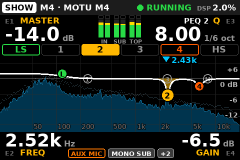

### 3.4 Hints on SHOW

Hints use the amber strip over the band chips, for 2.5 s (4 s for the notch helper and laptop
access). Example: `MASTER: SLOW DOWN`.

### 3.5 The meters and clipping

Six bars in three pairs (D-015), −60 … 0 dBFS: green below −18, yellow to −6, red above.
**IN L R** is the program input as it reaches the M4's converter, before any K1000 gain (the
spectrum's source); **SUB L R** and **TOP L R** are the outputs. A red box on top = that output
clipped; on the IN pair, `IN CLIP`. ALIGN shows the same meters, larger.

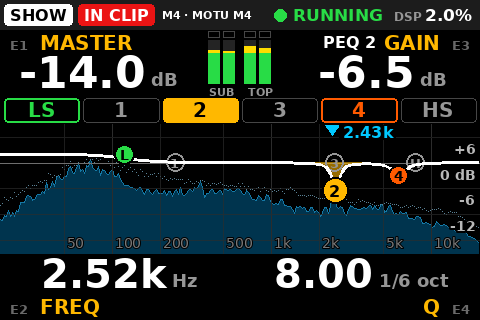

| Shows | Means | Do |
|---|---|---|
| `CLIP` (red pill) | An output reached full scale, or the engine counted clipped samples (held 3 s) | Master down; check the live EQ for a big boost |
| `IN CLIP` (red pill) | A program input reached −0.5 dBFS (held 3 s) | Source down, or inline pads. No K1000 knob fixes it |

The Meyers start limiting around −14 dBFS at the M4 outputs (research,
[chapter 5 §3](05-tuning.md#3-gain-structure)).

### 3.6 A band in or out

**Hold B3 on SHOW** (0.8 s): the selected band goes **OUT**, the strip says `P2 OUT`; hold again:
`P2 IN`. OUT keeps the band's frequency, gain and Q, and plays it at 0 dB: the same smoothed move as
turning its gain to 0 (no click), and back IN exactly as it was. To compare a cut with and without,
or to drop a cut that went wrong, without losing it. On the phone: hold the band's chip, without
sliding (D-014).

**Only once the buttons are confirmed.** Until SETUP › Knob test has proved which button is B3 and
`/etc/k1000/k1000.yaml` says so (a `controls: buttons` map written by hand, or the default kept
with `buttons_confirmed: true`), a B3 hold changes nothing and says
`B3 HOLD: IN/OUT AFTER KNOB TEST`: on a swapped map, that hold may be a mute aimed at B4, and a
notch going OUT would feed the ring. The phone's chip hold works either way.

An OUT band: its chip is dark with a dashed outline and a small `OUT`, its marker hollow and dashed
where its gain is, the curve without it, its values grey, and the pill `OUT P2` (several:
`OUT P2 LS`). Its knobs still move it, silently: the strip says `P2 OUT · HOLD B3 = IN` (before
the Knob test: `P2 OUT · IN FROM THE PHONE`).
SETUP › LIVE EQ › Reset live EQ puts every band back IN (its undo puts them back as they were).

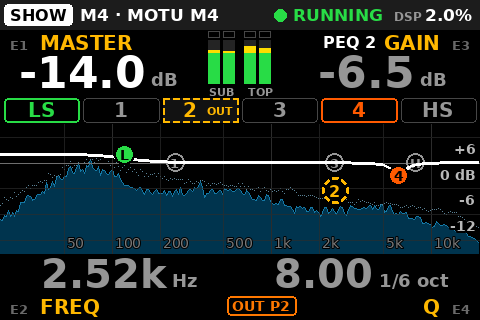

## 4. ALIGN

The system settings you set before the doors and leave alone: balance, the sub/top delay, Lo-Cut.

| Knob | Does | Step | Fine (push held) |
|---|---|---|---|
| E1 **MASTER** | As on SHOW | 0.5 dB | — |
| E2 **DELAY** | Which side is late, and by how much: clockwise from 0 the **subs**, anticlockwise the **tops**, up to 50 ms either way. The size big, the side and the distance over it (`SUBS LATER · 0.81 m`, `TOPS LATER · 0.43 m`, `ALIGNED`) | 0.1 ms | 1 sample (1/48 ms) |
| E3 **BALANCE** | Subs against tops, −12 … +12 dB; + = subs up. Subs get +b/2, tops −b/2 (`subs +1.5 · tops -1.5`) | 0.5 dB | — |
| E4 **LO-CUT** | The tops' high-pass, 12 dB/oct, 20 … 300 Hz | 2 Hz, speeds up (8 Hz on a fast spin) | 1 Hz |

Until D-015 (2026-10-14) BALANCE was E2 and DELAY E3. The meters in the middle: IN L R, SUB L R,
TOP L R ([§3.5](#35-the-meters-and-clipping)).

**E2 and E4, the two bottom knobs, are locked.** A turn shows `LOCKED · HOLD B2 TO EDIT` and
changes nothing. The bottom row says so between their labels: `DELAY ── LOCKED · HOLD B2 ── LO-CUT`.

- **Hold B2**: both unlocked (`DELAY + LO-CUT UNLOCKED`). The badge turns into an amber
  `EDIT 0:30` that counts down.
- Any knob or button on ALIGN renews it, so **30 s without input locks again**.
- **A B2 tap** locks at once (`DELAY + LO-CUT LOCKED`). Leaving ALIGN locks too.

 

 

**DELAY is one setting for both sides** (D-011). Subs in front of the tops: turn clockwise, the
subs wait (`SUBS LATER`). Tops in front: turn anticlockwise past 0, the tops wait (`TOPS LATER`).
Only the late side is ever delayed. Turning through zero stops one click on `0.00 · ALIGNED`; the
next click goes to the other side. It also keeps a wake-up click: after 2.5 s at rest, the first
click only wakes it (`DELAY · TURN AGAIN TO CHANGE`). Each change dips the group whose delay
changes (the subs or the tops; both when one write changes both, e.g. a quick turn through
zero): K1000 mutes the group around the write so it does not click. Do alignment before the show.

**Lo-Cut** frequencies sit on a 2 Hz grid; odd values only with the push held. A value saved
between two steps (112.25 Hz) stays until the first click, which lands on the next step in that
direction (114 up, 112 down).

**Lo-Cut off**: E4 reads `OFF` with `on/off in SETUP`. Switching it is SETUP › TOPS › Lo-Cut.

Why ALIGN is not the front page: a wrong-knob turn on a delay or a Lo-Cut during a show is worse
than no turn at all. The lock makes it a deliberate act. How to set these: [chapter 5](05-tuning.md).

## 5. SETUP

What is set once per rig, grouped by speaker floor (D-013); its knobs are D-017's. **Hold B1** on
SHOW or ALIGN to open it; a B1 tap (or hold) goes back to SHOW.

**The list.** Six groups, each under a header row: **TOPS**, **SUBS**, **INPUT**, **LIVE EQ**,
**PHONE**, **BOX**. **The selected row is always on the same screen row** (the 4th of 8): the list
scrolls under it, at the ends too (blank rows above the first item and below the last). The top
line says where you are (`TOPS 3/7`), a scroll bar at the right edge shows which part of the list
is in sight, and the bottom line says what E3 does on the selected row (`turn E3 = change`,
`turn E3 · push E3 = apply`, `push E3 = open`, `push E3 = run`, `push E3 ×2 = run`, `fixed here`).
Amber values ask for an E3 push (the risky rows, below).

| Knob | On SETUP |
|---|---|
| E1 turn | The item, one per click (headers are skipped; it stops at both ends) |
| E2 turn | The group: forward = the next group's first item; back = this group's first item, then the group before |
| E3 turn | **Changes the value**: a number moves; an ON/off goes ON to the right, off to the left. On a risky row it only proposes, in a popup (below) |
| E3 push | Applies the popup's proposal, opens a page, runs an action. Held while turning: fine steps |
| E1, E2 push | Nothing: a hint says what E3 does on the row (`TURN E3 TO CHANGE`, `PUSH E3 TO OPEN`…) |

**Everyday rows change as you turn E3**: the trims and every number, SUBS › Low-pass and LIVE EQ ›
Spectrum. An ON/off goes ON on a right turn and off on a left one, never back and forth on a fast
turn (`ALREADY ON` when it already is).

**Risky rows ask for an E3 push**: every pipeline rebuild (De-harsh, Mono L+R, Loudness, AUX IN,
Profile, Audition), both polarities and Lo-Cut. Turning E3 there opens a popup over the middle of
the list instead of changing anything:

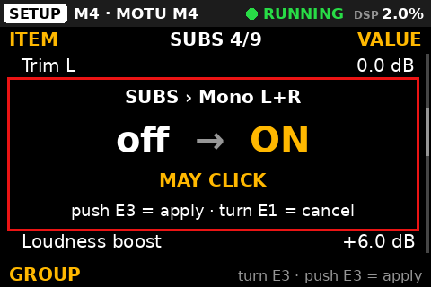

1. **Turn E3**: the popup shows the row, **now → proposed** (`off → ON`, `SUM → TOPS`,
   `off → MIC`), what it does (`MAY CLICK` on a rebuild, `FULL RANGE TO THE TOPS` for Lo-Cut off,
   `THE SUBS DIP A MOMENT` for a polarity flip) and `push E3 = apply · turn E1 = cancel`. More E3
   turns move the proposal (an ON/off: right ON / INVERTED, left off / normal; a choice: the next
   or previous one, stopping at both ends). Back on the current value, the popup closes.
2. **Push E3 to apply it.** Nothing changes before this push. A push let go after turning E3 (the
   fine-step habit) does not count, nor does a push pressed within 0.25 s of the popup opening or
   moving (a detent clicked by the pressing finger): it says `PUSH E3 TO APPLY`, push again.

An E1 or E2 turn cancels the popup (`CANCELLED`, the row stays selected), so does leaving the page,
or 8 s without an E3 turn; the page does not go home while it waits. If a phone set that value
meanwhile, the push says `NO CHANGE: ALREADY SET`.

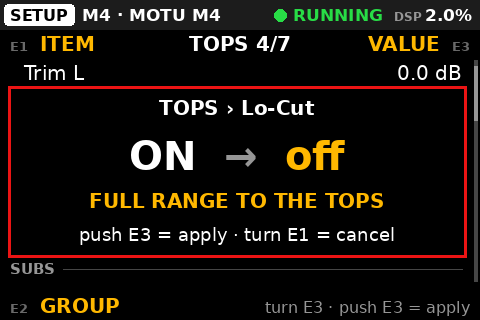 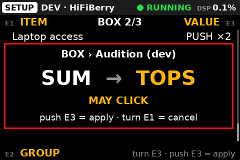

**Actions marked ×2** (Reset live EQ, opening Laptop access): the first E3 push opens the same
popup (`Reset live EQ?`, `Open laptop access?`, with what it does), a second E3 push within 5 s
runs it. An E1 or E2 turn, or leaving the page, cancels.

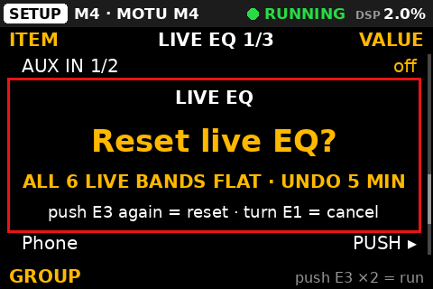

**Read-only rows** are dimmed, and the bottom line says `fixed here`. A turn or a push only says
why:

| Row | Shows | Why |
|---|---|---|
| BOX › Profile | `DEV · PINNED` | `k1000.yaml` names the profile: `PROFILE PINNED IN k1000.yaml` |
| BOX › Audition (dev) | `—` | Not the bench profile: `AUDITION: DEV PROFILE ONLY` |
| LIVE EQ › Spectrum | `DISABLED` | `spectrum: enabled: false` in `k1000.yaml`: `SPECTRUM OFF IN k1000.yaml` |
| INPUT › AUX IN 1/2, AUX level | `NO SPARE INPUT`, the level greyed | The profile has no input left over for AUX (the bench HiFiBerry: its two inputs are the program): `AUX: NO SPARE INPUT ON THIS DEVICE`. The phone shows both rows read-only and the box refuses their edits |

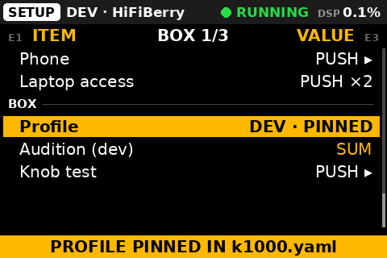 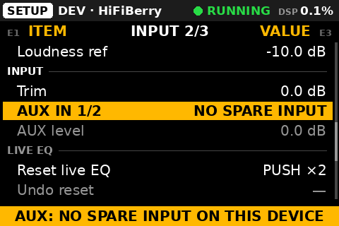

| Group › item | How | Does |
|---|---|---|
| TOPS › Trim L, Trim R | E3 | −24 … +6 dB: to match boxes or sides, not to set the level |
| TOPS › Polarity | E3, push E3 | `normal` / `INVERTED`. The tops dip briefly. Pill `POL INV TOP` |
| TOPS › **Lo-Cut** | E3, push E3 | The tops' high-pass on or off (`ON · 100 Hz` / `off · 100 Hz`; the frequency is ALIGN E4): `LO-CUT ON · 100 Hz` or `LO-CUT OFF`. Off parks the filter at 10 Hz (no pipeline change). Pill `LO-CUT OFF` |
| TOPS › De-harsh | E3, push E3 | `off` / `ON` (D-016, off by default): a cut around **De-harsh freq** that acts only while that band is louder than **De-harsh thresh**, on hard attacks; quieter, it does exactly nothing. Rebuilds the pipeline (`MAY CLICK`): `DE-HARSH ON`. Pill `DE-HARSH`. How to set it: [chapter 5 §9](05-tuning.md#9-de-harsh-and-sub-loudness-by-ear) |
| TOPS › De-harsh freq | E3 | 1.50k … 6.00k Hz, 1/12 octave (2.70k by default, the harsh band of the first rig run); the band is about an octave wide. No click |
| TOPS › De-harsh thresh | E3 | −48 … 0 dB, 0.5 dB (−24 by default): the band level where the cut starts (3:1 above it). Lower = it acts more often. It reads the left and right bands summed: a centred source reads 6 dB over one side's level. At 0 dB it never acts |
| SUBS › Trim L, Trim R | E3 | As the tops' trims |
| SUBS › Polarity | E3, push E3 | `normal` / `INVERTED`. The subs dip briefly. Pill `POL INV SUB` |
| SUBS › Mono L+R | E3, push E3 | Both subs get L+R. **Keep it ON with one cable to both subs** (OUT3, D-012): OFF puts the left channel alone on them. Rebuilds the pipeline (the popup says `MAY CLICK`), then the blue `APPLYING SETUP…` with Main muted around it |
| SUBS › Low-pass | E3 | A 12 dB/oct low-pass on the subs, on (E3 right) or off (left), at once |
| SUBS › Low-pass freq | E3 | 40 … 250 Hz, 1/12 octave |
| SUBS › Loudness | E3, push E3 | `off` / `ON` (D-016, off by default): the subs' low shelf (70 Hz) rises as the master goes under **Loudness ref**, so the subs keep filling the room at low level. At or above the reference it adds nothing; the subs are **never louder than at the reference**. Rebuilds the pipeline (`MAY CLICK`): `LOUDNESS ON`. Pill `LOUDNESS`. How to set it: [chapter 5 §9](05-tuning.md#9-de-harsh-and-sub-loudness-by-ear) |
| SUBS › Loudness boost | E3 | 0 … +12 dB, 0.5 dB (+6 by default): the extra low end reached 20 dB under the reference (half of it 10 dB under). It rises like a trim, step by step, and the phone's raises share master's 6 dB/s |
| SUBS › Loudness ref | E3 | −40 … 0 dB master, 0.5 dB (−10 by default): the master level where the subs sound right without help |
| INPUT › Trim | E3 | −24 … +12 dB, 0.5 dB. Acts after the converter: it cannot fix `IN CLIP` |
| INPUT › AUX IN 1/2 | E3, push E3 | `off` / `MIC` / `LINE` (D-016, off by default): the M4's front inputs into the program. **MIC**: IN1 on both sides at −3 dB each, under a 100 Hz high-pass. **LINE**: IN1 left, IN2 right. AUX joins after the input trim (the trim is the program's only) and before the EQ (it gets the system EQ, the live EQ and de-harsh). Rebuilds the pipeline (`MAY CLICK`): `AUX IN 1: MIC`, `AUX IN 1/2: LINE`. Pill `AUX MIC` / `AUX LINE`. Read-only `NO SPARE INPUT` on the bench profile. **A mic: master down first, M4 GAIN 1/2 up from minimum, MON 1/2 stay unlit, then AUX level** |
| INPUT › AUX level | E3 | −40 … +12 dB, 0.5 dB (0 by default): the AUX's own level, after the M4's GAIN knob. It rises like a trim; the phone's raises share master's 6 dB/s |
| LIVE EQ › **Reset live EQ** | push E3 ×2 | The popup `Reset live EQ?`, then the four bells and both shelves go flat, smoothly: `LIVE EQ RESET · UNDO IN SETUP` (`LIVE EQ ALREADY FLAT` if there was nothing to reset) |
| LIVE EQ › **Undo reset** | push E3 | Puts back exactly the live EQ the last reset flattened: `LIVE EQ RESTORED`. The row counts down (`UNDO 4:47`); `—` and greyed when there is nothing to undo (`NOTHING TO UNDO`) |
| LIVE EQ › **Spectrum** | E3 | `ON` (E3 right) / `off` (left), at once, saved. Read-only `DISABLED` when `spectrum: enabled: false` in `k1000.yaml` |
| PHONE › Phone | push E3 | Opens the PHONE page ([§5.3](#53-the-phone-page)) |
| PHONE › **Laptop access** | push E3 ×2 to open, once to close | CamillaGUI, SSH and the `/tune` page from a laptop on the K1000 Wi-Fi, for 2 h ([§5.1](#51-laptop-access-and-the-tune-page)) |
| BOX › Profile | E3, push E3 | `DEV` / `M4`. Read-only while `k1000.yaml` pins it. About 1 s of silence, then the ramp |
| BOX › Audition (dev) | E3, push E3 | Bench profile only: `SUM`, `TOPS`, `SUBS` on the two bench outputs. Rebuilds the pipeline |
| BOX › Knob test | push E3 | Opens the Knob test ([§5.4](#54-knob-test)) |

**The undo** keeps one level, for **5 minutes, or until the next audible live-EQ edit**: a gain
moved off 0 dB on any band, from the knobs, the phone or CamillaGUI. That edit ends it and says
`RESET UNDO LOST`. Inaudible moves (B3, a frequency or Q turned on a flat band) keep it. The phone's
reset is the same reset: the box can undo it.

 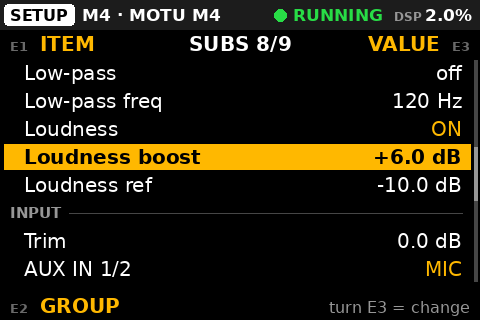

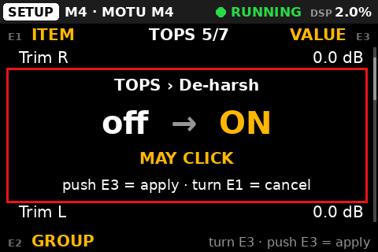 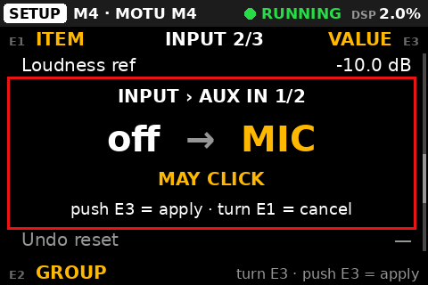

During a show, SETUP is for Reset live EQ and Undo reset only, and the D-016 numbers (De-harsh
freq and thresh, Loudness boost and ref, AUX level) if needed: they move without a click. Polarity,
trims, Mono L+R, the profile and the three D-016 switches (a rebuild each) belong before the doors.

### 5.1 Laptop access and the tune page

At the rig the laptop reaches the box over the **K1000 Wi-Fi**. A fence normally keeps CamillaGUI
and SSH away from that Wi-Fi; Laptop access opens exactly those two, for a while.

1. SETUP › PHONE › Laptop access, **push E3 twice** (the first opens the popup
   `Open laptop access?`). The row reads `OPENING…`, then `OPEN 2:00` counting down
   (hours:minutes); SHOW shows the pill `LAPTOP OPEN 1:59`; the hint says
   `LAPTOP OPEN 2 H · GUI :5005 · SSH`.
2. SETUP › PHONE › Phone: while access is open, the PHONE page prints the Wi-Fi password on every
   step (a laptop cannot scan the QR). Join **K1000** with it.
3. On the laptop:
   - the tune page: `https://10.42.0.1/tune` (it needs the K1000 CA like a phone, or accept the
     browser's warning once);
   - CamillaGUI: `http://10.42.0.1:5005/gui/index.html` (press *Fetch from DSP* before editing);
   - SSH: `ssh k1000@10.42.0.1`.
4. Done: **one E3 push** on SETUP › PHONE › Laptop access (`LAPTOP ACCESS CLOSED`).

It also closes by itself after **2 hours** (`LAPTOP ACCESS CLOSED (2 H)`), when the k1000
service stops or starts again, and at every boot. Closing refuses new connections at once; an open
SSH session or GUI page stays until it ends. **Phones on the K1000 Wi-Fi reach the same two ports
while it is open**: open it for the tune, close it after.

| Row or hint | Means |
|---|---|
| `N/A` (greyed), `LAPTOP ACCESS: NOT AVAILABLE` | No laptop-access service on this box |
| `LAPTOP ACCESS: NO ANSWER (SEE LOG)` | The root helper did not answer: [`docs/06-phone.md`](../06-phone.md) §7 |
| `LAPTOP ACCESS NO WI-FI FENCE (AP NOT SET UP)` | There is no K1000 Wi-Fi to open: use the wired network |

**The tune page** (`/tune`) imports a measured EQ: paste REW's *Export filter settings as text*
(or EqualizerAPO `Filter` lines, or `125 Hz -4 dB Q 5` typed by hand), check the preview on the
eight system bands, **Apply** (with a confirm; click-safe, saved at once), and **Undo** if needed
(one level). Peaking filters only, eight at most. How to measure and decide:
[chapter 5 §7](05-tuning.md#7-system-eq).

### 5.2 Hints on SETUP

The footer shows a hint (2.5 s), else, when muted, the MUTED strip; a popup never covers it. The
hints: `TURN E3 TO CHANGE` (a push on a number or an ON/off), `PUSH E3 TO OPEN`, `PUSH E3 TO RUN`,
`PUSH E3 TWICE TO RUN` (E3 turned on a page or an action, or E1/E2 pushed), `PUSH E3 TO APPLY`
(E1/E2 pushed with a popup open), `CANCELLED` (E1 or E2 turned with a popup open),
`ALREADY ON`, `ALREADY OFF`… (E3 turned toward the value the row holds), `NO CHANGE: ALREADY SET`,
and the read-only reasons ([§5](#5-setup)).

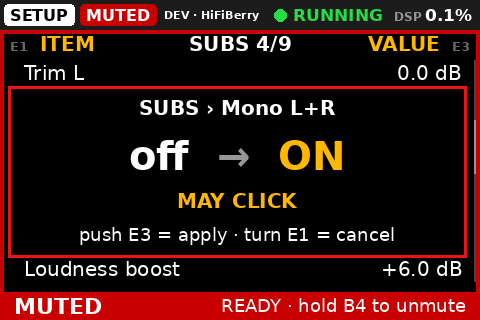

### 5.3 The PHONE page

The QR codes a phone needs, and the phone switch. **E1 turn**: the next code, `1 · JOIN WI-FI` →
`2 · OPEN K1000` → `FIRST TIME` (the certificate page). Once a phone is on the Wi-Fi the page shows
step 2 by itself. **E1 push**: phone control on/off (`PHONE CONTROL ON` /
`PHONE OFF · KNOBS ONLY`, kept across restarts). **B1 tap**: back to SETUP; **B1 hold**: SHOW.
B4 still mutes.

The right column says `Wi-Fi AP ON` (green) or `Wi-Fi AP is OFF` (red, with the reason), the band
and channel, and how many devices are on the Wi-Fi and on the page (`1 on Wi-Fi · 1 on K1000`).
The phone itself: [§8](#8-the-phone).

### 5.4 Knob test

Every physical knob (`enc0`–`enc3`) and switch (`sw0`–`sw7`) with the role the `controls:` map gives
it, and a line for the last event. Turn and press each control, note which `enc`/`sw` index sits
where, and write them into `controls:` ([chapter 3 §5](03-configuration.md#5-controls)). **Hold B4
still mutes** here. Holding any other control goes back to SETUP. The test names each switch by
its place in `controls:` (sw4–sw7 = B1–B4 by default), so pressing the four buttons in turn shows
which one the code calls B1, B2, B3, B4: label the shell from that.

## 6. Mute

**Hold B4 for 0.8 s, on every page**: SHOW, ALIGN (locked or not), SETUP (an open popup
survives), PHONE and the Knob test. A tap only shows `HOLD B4 TO MUTE / UNMUTE`.

- The mute and the unmute fade over 0.1 s. A mute is saved **at once**: switched off muted, the box
  comes back muted.
- **B4 acts on what the screen showed when you pressed it.** Pressed on an unmuted box, it always
  mutes. Pressed on a muted box, it unmutes only if nobody changed the mute meanwhile; if a phone
  did, it says `MUTE CHANGED · LOOK, HOLD B4 AGAIN`.
- While K1000 itself holds Main muted on its way in (`RAMPS IN BY ITSELF`), B4 means **keep it
  muted**, never unmute.
- K1000 never releases a mute it did not make (a mute from CamillaGUI stays).

**What MUTED looks like:** the red `MUTED` pill and a red frame on every page; on SHOW and ALIGN a
red band with the next step next to it; on SETUP and PHONE a red footer (a band would hide the row,
the popup or the QR); on the Knob test a red tag.

| Band text | Means |
|---|---|
| `READY · hold B4 to unmute` | Your mute (or a mute saved at power-off). The engine runs and K1000 is in sync |
| `hold B4 to unmute` | Muted, but the engine is not running yet or K1000 is not in sync: wait for `READY` |
| `RAMPS IN BY ITSELF · hold B4 to keep muted` | The engine (re)started: K1000 fades Main in over about 3 s by itself |
| an alert (`NO AUDIO FLOWING · HELD MUTED`, `APPLYING SETUP…`, `KNOBS OFFLINE …`) | Why it is still muted: [chapter 6 §1](06-troubleshooting.md#1-the-screen) |

From the phone: *MUTE* (hold 0.6 s), *MUTED* (hold 1.2 s to unmute), with the same rule
([§8](#8-the-phone)).

## 7. Alerts, hints and pills

Three kinds of message. They never share a place or a colour.

| Kind | Says | Where | Colour |
|---|---|---|---|
| **Alert** | The system has a problem, or is in a passing state | The **status bar** (the page pill shortens to `SHW`, `ALN`, `SET`). Also inside the MUTED band. A critical alert is repeated over SHOW's chips when no hint is up | **Red** = critical (`KNOBS OFFLINE` takes the whole bar), **orange** = warning, **blue** = passing state |
| **Hint** | What your own press just did | The **amber strip**: SHOW's chip row, ALIGN's middle, SETUP's footer | Amber, 2.5 s (4 s for the notch and laptop access) |
| **Pill** | A non-default state that lasts | SHOW's bottom row | Orange (risky) or grey |

 

The alerts, most urgent first:

| Alert | Level |
|---|---|
| `KNOBS OFFLINE · USE PHONE MUTE / BYPASS` or `KNOBS OFFLINE · SOURCE DOWN / BYPASS` | critical. **B4 does nothing meanwhile.** The first text only while a phone can mute right now (phone servers on, SETUP › PHONE › Phone on, the Wi-Fi up, the page served); otherwise the second |
| `NO DEVICE · MOTU M4`, `ENGINE DOWN` (also full-screen) | critical |
| `CANNOT SAVE STATE`, `ENGINE SYNC FAILED (SEE LOG)` | critical |
| `SETTINGS: …`, `k1000.yaml ROUTING FIXED UP (SEE LOG)`, `NO AUDIO FLOWING · HELD MUTED` | warning |
| `PIPELINE CHANGED (GUI)`, `CONFIG DRIFT (SEE LOG)`, `RESTORING ENGINE DEVICES`, `DEVICES CHANGED (GUI)`, a cut kept from CamillaGUI (`SUBS GROUP MUTED (GUI)`, `N CUTS/MUTES (GUI)`…) | warning |
| `APPLYING SETUP…`, `RAMPING IN` | passing state (blue) |

What each one means and what to do: [chapter 6 §1](06-troubleshooting.md#1-the-screen).

## 8. The phone

A page served by the box on its own Wi-Fi, **K1000**. It drives the same controller as the knobs:
same ranges, same click-safe moves, one state. The knobs stay the main surface and B4 the master
mute. Use the phone at a show only once it has been proven with your phone on your box
([`docs/06-phone.md`](../06-phone.md) §9 has the checklist).

### 8.1 Once per phone, at home

1. **The K1000 certificate.** The phone needs a screen lock. Put the CA's public certificate
   (`k1000-ca.crt`) on the phone, or get it from the box: E1 to the `FIRST TIME` QR (or
   `http://10.42.0.1/` in Chrome), *Download the K1000 certificate*, *Keep*. **Do not tap the
   file.** Install it from Settings › Security › Encryption & credentials › Install a certificate
   › **CA certificate**. *Network may be monitored* is expected: this CA can only vouch for the
   K1000 box.
2. **Join the Wi-Fi.** SETUP › PHONE › Phone, first QR. Scan it from Settings › Wi-Fi (the QR
   icon), not the camera app: Android then asks *K1000 has no internet access — Stay connected?* →
   **Yes**, **Don't ask again**. The password is printed under the QR.
3. **Open and install the page.** The second QR, or `https://10.42.0.1/`. Then *Install* in the
   page's top bar, or ⋮ › *Add to Home screen*.

Step by step, other Android menus and the fixes: [`docs/06-phone.md`](../06-phone.md) §3 and §7.

### 8.2 At the gig

**Airplane mode, then Wi-Fi on** → the phone joins K1000 → tap the K1000 icon. The top bar shows
`LINK` and `RUNNING`. With mobile data on, Android may send the page to the mobile network instead.

### 8.3 What it does

| Tab | Controls |
|---|---|
| **MAIN** | Master −6 / −1 / −½ / +½ / +1 dB. Balance ±½ / ±1 dB. Lo-Cut on/off (with a confirm) and its frequency (−10 / −2 / +2 / +10 Hz) |
| **LIVE EQ** | The six live bands on a graph. **Drag a dot** = frequency and gain. **Long-press empty space = notch here**: the first flat bell goes there at **−6 dB, Q 8, at once** (audible, unlike B3) and stays under the finger: slide to tune it. **Tap a band chip** = select it; **hold a chip** (0.6 s) = that band **IN / OUT** (`P2 OUT`, the chip dashed, its dot hollow). Per band: FREQ, GAIN, Q steps; *FLAT* (hold) = this band to 0 dB and IN. *ALL FLAT…* with a confirm (the undo is on the box) |
| Always | **Hold to mute** (0.6 s; unmute 1.2 s), the four meters, the engine state, the box's alerts, changes made outside K1000 |

- **What a hold does is decided when the finger goes down**, and the button says it:
  *MUTE*, *MUTED* (hold to unmute), or *KEEP MUTED* (K1000 is bringing the sound in
  by itself). An unmute is cancelled if anyone changed the mute during the hold (*The mute changed
  meanwhile*). The phone buzzes when the box confirms; no answer in 1.5 s says *No answer from
  K1000: use B4 on the box*.
- **Master** rises at most +1 dB per tap and +6 dB per second for all phones together, and the
  box's master-up guard applies on top (6 dB within 2 s). Down is never limited.
- At most **4 phones** at once.

**It cannot** change the profile, Mono L+R, the delay, a polarity, the trims, the input trim, the
sub low-pass or the system EQ, nor run Undo reset, the Spectrum switch, Laptop access or phone
on/off. It has no spectrum.

### 8.4 Switching it off

- **For now:** SETUP › PHONE › Phone (push E3), then push E1 on the PHONE page: `PHONE OFF · KNOBS ONLY`. The page still opens
  but controls nothing. It stays off across restarts.
- **For a show (no-go):** `phone: enabled: false` in `/etc/k1000/k1000.yaml` (then
  `sudo systemctl restart k1000`, between shows) **and** the Wi-Fi off the air:
  `sudo /opt/k1000/net/setup-ap.sh --down`. It stays down across reboots and later
  `install.sh --ap` runs; `setup-ap.sh --up` brings it back.
- **A laptop on the box's Ethernet** must not share its connection on 10.42.0.0/24 (NetworkManager's
  *Shared to other computers* default): that is the K1000 Wi-Fi's subnet, and the box keeps its
  Wi-Fi down while another interface holds such an address (PHONE: `Wi-Fi AP is OFF` · `eth0
  10.42.0.x` · `is in the AP subnet`). Share on another subnet, e.g. 10.43.0.1/24.

## 9. During a show

- Stay on **SHOW**. Master on E1; ring control with B3, E4 (gain), E3 (Q).
- Leave ALIGN locked and SETUP alone, except Reset live EQ / Undo reset and, if needed, the D-016
  numbers (De-harsh freq and thresh, Loudness boost and ref, AUX level): they move without a click.
- No CamillaGUI Apply, and Laptop access closed.
- Never Mono L+R, Profile, Audition, De-harsh, Loudness or AUX IN: they rebuild the pipeline (a
  click).
- `NO SPECTRUM`: SETUP › LIVE EQ › Spectrum off; the sound is not affected.

| Emergency | Do |
|---|---|
| Silence now | **Hold B4** |
| Feedback | On SHOW: **B3**, **E4 down**, **E3 up** (no B1 needed). From ALIGN or SETUP: tap B1, wait for the cyan PEAK (about 2 s), then B3 |
| `KNOBS OFFLINE` (B4 dead) | The phone's mute if the alert says so; else the source down. Then bypass |
| Any doubt about the sound | **Bypass** ([§11](#11-the-bypass)) |

## 10. End of the night

**Hold B4** (MUTED, saved at once) → **speakers off** → unplug K1000 → unplug the M4.

The next power-on stays silent (`READY · hold B4 to unmute`) until you unmute. Pulling the plug is
the normal way to switch K1000 off ([chapter 7](07-maintenance.md#power-cuts)).

## 11. The bypass

**Bypass = the source straight into the speakers, as it was cabled before K1000.** About a minute:

1. **Source down.** Hold B4 if K1000 still answers.
2. Unplug OUT1 TOP L, OUT2 TOP R and OUT3 SUBS (OUT4 too if it is patched) at the speakers.
3. Patch the bypass kit as written on the operator card.
4. **Source up slowly.** The bypass is about (10 − master − input trim) dB louder: +20 dB at
   master −10 with the trims at 0 (measured on the M4, 2026-10-16).

Lost in bypass: the Lo-Cut, the delays, the EQ, the mute. Details:
[chapter 6 §4](06-troubleshooting.md#4-the-bypass).

## 12. More pictures

Every screen the code draws is in `docs/ui/`, redrawn by `python3 -m k1000.ui.pages ../docs/ui`
([chapter 8](08-development.md#the-bench-console)): `show*.png`, `align*.png`, `setup*.png`,
`hwtest*.png`, `phone_*.png`, the alerts (`alert_*.png`, `knobs_offline*.png`, `no_device.png`,
`engine_down.png`, `unknown_status.png`) and the mute views (`muted*.png`).
